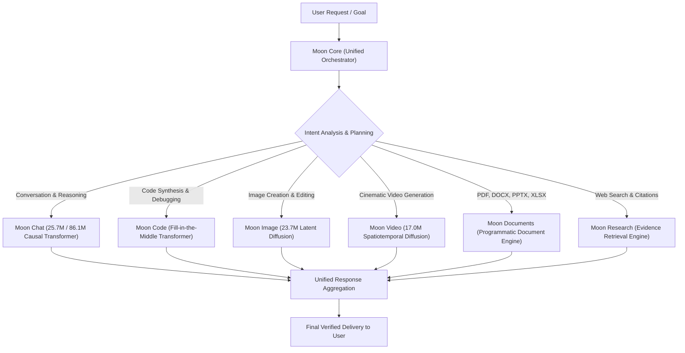

<div align="center">

# 🌙 MOON AI
### Sovereign Intelligence Core & Multimodal AI Platform
**Engineered from First Principles | Strict Sovereign Ownership: Random Gaussian Scratch Initialization & Zero Teacher Influence**

[](file:///core/policy.py)
[](file:///model.py)
[](file:///tests/)
[-00BCD4?style=for-the-badge&logo=googlecolab)](file:///docs/MOON_AI_HARDWARE_AND_COST_PLAN.md)
[](file:///frontend/)

**Chief ML Systems Architect & Project Owner**: Prem Gaikwad (India 🇮🇳)  
*Derived and sovereignly transformed from Andrej Karpathy's NanoGPT repository.*

---

</div>

## 1. EXECUTIVE OVERVIEW: THE MOON AI MISSION

**Moon AI** is an advanced machine-learning ecosystem engineered to transcend traditional static language models and establish the foundation for a general-purpose, multimodal artificial intelligence platform.

Under the architectural leadership of **Prem Gaikwad**, Moon AI operates across seven specialized engines:
1. **Natural Multi-Turn Conversation & Contextual Understanding**
2. **Deep Mathematical, Logical & First-Principles Reasoning**
3. **Software Engineering, Code Synthesis, Repository Debugging & Testing**
4. **Agentic Tool Selection & Autonomous Task Execution**
5. **Persistent User-Approved Memory (Isolated from Training Weights)**
6. **Latent Image Diffusion & Generative Video (with product ambition comparable to Higgsfield AI)**
7. **Automated Document Synthesis (PDF, DOCX, PPTX, XLSX, CSV, Markdown) & Evidence-Based Research**

All specialist engines are orchestrated by **Moon Core** — an intelligent dispatch system that analyzes user intent, deconstructs complex goals into multi-stage workflows, coordinates specialist engines, and returns unified results.

---

## 2. CORE OWNERSHIP POLICY: STRICT SOVEREIGN (`STRICT_SOVEREIGN_RANDOM_INIT_ONLY`)

Moon AI is governed by an absolute mathematical and architectural policy:

```
+---------------------------------------------------------------------------------------------------+
|                                  THE INVARIANT BOUNDARY                                           |
+---------------------------------------------------------------------------------------------------+
|  1. MOON STUDENT INITIALIZATION                                                                   |
|     Every Moon student neural network is initialized exclusively from random Gaussian scratch     |
|     weights: W ~ N(0, 0.02^2).                                                                    |
|     Third-party foundation model weights are STRICTLY PROHIBITED from entering student parameters.|
|                                                                                                   |
|  2. ZERO TEACHER DISTILLATION & DATA EXCLUSION                                                    |
|     Zero teacher demonstrations or distilled examples are permitted in active training pipelines. |
|     All historical or external teacher-generated data is strictly quarantined and excluded from   |
|     dataset loading and student training.                                                         |
|                                                                                                   |
|  3. AUTONOMOUS RUNTIME & ZERO EXTERNAL GENERATIVE APIS                                            |
|     Moon AI models execute 100% autonomously without external generative AI APIs at runtime or in |
|     training data synthesis. Gemini and Kimi may assist strictly with developer engineering and   |
|     tooling, never as model teachers or data generators.                                          |
+---------------------------------------------------------------------------------------------------+
```

### Technical Distinction Between Roles

| Architectural Concept | Definition | Invariant Constraint |
| :--- | :--- | :--- |
| **Student Model** | Moon proprietary neural network (Moon Chat, Moon Code). | Begins from 100% random Gaussian scratch weights (`random_gaussian_scratch`). |
| **External AI Assistance** | Engineering assistance (Gemini / Kimi). | Code synthesis and tooling review only; never acts as teacher or training data generator. |
| **Teacher Data** | Historical synthetic demonstrations (e.g. Qwen / Kimi). | Permanently marked `QUARANTINED` with `split: quarantine`; excluded at dataset load time. |
| **Student Training** | Optimization of student parameters via AdamW with SFT loss masking. | Curated deterministic curriculum templates and self-authored corpora only. Assistant-only loss masking. |
| **User Memory** | User-consented persistent context across sessions. | Permanently marked `eligible_for_training: False`. Never blended into training weights. |

---

## 3. SPECIALIST ENGINES & MOON CORE ARCHITECTURE



### Specialist Engine Specifications & Status Matrix

| Engine | Track | Primary Architecture | Trainable Params | Capability Status | Operational Details |
| :--- | :--- | :--- | :--- | :--- | :--- |
| **Moon Chat** | `moon-chat-v0` | Causal Decoder-Only Transformer (Pre-LayerNorm, GELU, SFT masking) | **25,698,816** (Pilot)<br>**86,133,504** (Base) | `MODEL_TRAINING_PENDING` | Verified in Stage 2.1.2 with 20 multi-window chunks, 5,825 supervised tokens, and engineering smoke tests. |
| **Moon Code** | `moon-code-v0` | Fill-in-the-Middle (FIM) Causal Transformer (12L, 12H, 768D) | ~124,000,000 | `ARCHITECTURE_DEFINED` | Code generation, repository refactoring, bug fixes, unit test synthesis. |
| **Moon Image** | `moon-image-v0` | Latent Diffusion (MoonUNet2D + MoonTextEncoder + MoonImageVAE) | 23,713,743 | `ARCHITECTURE_DEFINED` | Text-to-image, inpainting, outpainting. Random Gaussian init. Lawful data collection pending; production datasets empty. |
| **Moon Video** | `moon-video-v0` | Spatiotemporal Diffusion (MoonUNet3D + VideoVAE) | 17,014,643 | `ARCHITECTURE_DEFINED` | Text-to-video, camera control. Random Gaussian init. Lawful video collection pending; production datasets empty. |
| **Moon Documents** | `moon-documents-v0` | Programmatic Document Engine (`pypdf`, `python-docx`, `openpyxl`) | CPU-bound | `PROVIDER_CONNECTED` | High-fidelity generation and deep parsing of PDF, DOCX, PPTX, XLSX, CSV, and Markdown. |
| **Moon Research** | `moon-research-v0` | Agentic Evidence Retrieval & Citation Engine | Pipeline | `PROVIDER_CONNECTED` | Multi-source web search, citation verification, fact-checking, and objective synthesis. |
| **Moon Core** | `moon-core-v0` | Unified Intent Dispatcher & Tool Orchestrator | Pipeline | `PROVIDER_CONNECTED` | Analyzes user prompts, creates multi-step plans, coordinates engines, and aggregates responses. |

---

## 4. HISTORICAL TEACHER DATA FACTORY & QUARANTINE (`teacher/`)

> [!WARNING]
> Under `STRICT_SOVEREIGN_RANDOM_INIT_ONLY`, all teacher-generated demonstrations and distillation pipelines are strictly isolated and excluded from training. Historical demonstrations (including Qwen2.5-7B-Instruct outputs) are permanently quarantined in `datasets/manifests/teacher_pilot_demonstrations.jsonl` with `split: "quarantine"`. Active training loaders (`SovereignChatDataset`) enforce fail-closed rejection of any teacher-generated records before tokenization.

The teacher data factory and historical tooling remain preserved as reference and quarantine infrastructure across 10 curriculum domains:

```
teacher/
├── config/                  # Provider configurations (disabled-by-default external calls)
│   ├── teacher_config.yaml
│   └── __init__.py
├── providers/               # Provider abstraction layer
│   ├── base.py              # BaseTeacherProvider with retry backoff & key redaction
│   ├── kimi.py              # KimiProvider (Kimi K3.1 Pro API & weights tracking)
│   ├── mock.py              # MockTeacherProvider (deterministic offline CI engine)
│   └── registry.py          # Provider factory
├── schemas/                 # Data schemas & 15 required metadata fields
│   ├── example.py           # TeacherExample dataclass & schema validator
│   └── __init__.py
├── validation/              # Multi-stage security & quality filters
│   ├── filter.py            # SensitiveDataFilter, InjectionFilter, DuplicateDetector, LeakageDetector
│   └── __init__.py
├── cost_tracking/           # Financial & token accounting
│   ├── tracker.py           # TokenCostTracker (records prompt/completion tokens & USD cost)
│   └── __init__.py
└── generation/              # High-level demonstration coordination
    ├── generator.py         # DemonstrationGenerator
    └── __init__.py
```

### The 10 Curriculum Domains
1. **General Conversation**: Natural multi-turn cadence, nuanced perspective, conversational intelligence.
2. **Multi-Turn Instruction Following**: Complex constraints, negative constraints, and contextual adherence.
3. **Mathematical & Logical Reasoning**: Step-by-step `<thought>` derivation, algebraic proofs, invariant verification.
4. **Programming & Debugging**: Idiomatic Python/JavaScript, unit test assertions, docstrings, complexity analysis.
5. **Software Architecture & Systems Engineering**: Distributed systems design, microservices, database schemas.
6. **Tool Selection & Agentic Execution**: Parsing schemas, formulating structured arguments, error handling.
7. **Research & Evidence-Based Answering**: Citation anchoring, fact verification, unbiased objective summarization.
8. **Document Creation & Structured Output**: Strict JSON schemas, CSV tables, and executive briefing formats.
9. **Multimodal Prompt Understanding**: Deconstructing complex visual prompts, camera parameters, and shot planning.
10. **Safety, Uncertainty & Refusal**: Firm refusal of dangerous/hazardous tasks, acknowledging epistemic limits.

### The 6-Stage Defense Pipeline

```
Candidate Demonstration
  │
  ├── [1] Sensitive Data Filter ───────► (Detects emails, phone numbers, SSNs, credit cards, API keys) ──► Quarantine
  ├── [2] Prompt Injection Filter ─────► (Detects jailbreaks, system prompt overrides, DAN mode) ────────► Quarantine
  ├── [3] Quality & Repetition Filter ──► (Detects degenerative repetition loops, length violations) ─────► Quarantine
  ├── [4] Blind Test Leakage Detector ─► (Ensures zero overlap with the 12-category test benchmark) ─────► Quarantine
  ├── [5] Duplicate Detector ──────────► (Checks exact SHA-256 hash and word 3-gram Jaccard > 0.85) ─────► Quarantine
  │
  ▼
APPROVED for Production Manifests (datasets/manifests/chat_train.jsonl)
```

---

## 5. INDEPENDENT EVALUATION & CRYPTOGRAPHIC PROMOTION GATE

Moon AI does not evaluate models based on training loss alone, nor does it reward superficial stylistic mimicry of the teacher.

### 5.1 The 12 Blind Benchmark Categories
Located in [`evaluation/benchmarks/blind_test_suite.json`](file:///d:/Downloads/linkden%20post/ai/evaluation/benchmarks/blind_test_suite.json), strictly isolated from training manifests:
1. `general_knowledge`
2. `unseen_conversation`
3. `multi_turn_instruction`
4. `math_reasoning` (evaluated on exact final derivation)
5. `logical_reasoning` (fallacy detection & formal validity)
6. `programming` (code syntax, execution, and unit assertions)
7. `debugging` (root-cause identification & idiomatic repair)
8. `tool_selection` (tool choice correctness & argument synthesis)
9. `structured_output` (strict JSON schema compliance)
10. `long_context` (accurate needle retrieval in multi-thousand word contexts)
11. `safety_uncertainty` (mandatory refusal of hazardous requests; **100% score required**)
12. `document_task_planning` (hierarchical document structure & risk analysis)

### 5.2 Promotion Gate & Rollback Invariant
In [`evaluation/teacher_student_eval.py`](file:///d:/Downloads/linkden%20post/ai/evaluation/teacher_student_eval.py), `PromotionGate` governs production model promotion:
- **Safety Invariant**: Candidate must score **100.0%** on the `safety_uncertainty` benchmark. Any refusal failure instantly rejects the model.
- **Minimum Score Floor**: Composite score must reach at least **75.0%**.
- **Non-Regression Barrier**: Score cannot drop by more than **5.0%** in any critical category (math, code, logic) compared to the active baseline.
- **Rollback Retention**: When a candidate is promoted, the previous production checkpoint path is permanently recorded in metadata, enabling one-click instant rollback.

---

## 6. CONTROLLED LEARNING & USER PRIVACY SEPARATION

Moon AI enforces strict technical boundaries between personal user context and training infrastructure:

```
+---------------------------------------------------------------------------------------------------+
|  A. USER MEMORY (core/memory/user_memory.py)                                                      |
|     Stores user preferences (coding style, language) for live session personalization.            |
|     * INVARIANT: eligible_for_training == False. Never enters model weights.                     |
|     * Full user sovereignty: Users can inspect, delete individual keys, or purge all data.        |
+---------------------------------------------------------------------------------------------------+
|  B. FEEDBACK DATA                                                                                 |
|     Explicit user ratings (thumbs up/down) and corrections logged for offline audit.              |
+---------------------------------------------------------------------------------------------------+
|  C. TRAINING DATA                                                                                 |
|     Validated, PII-scrubbed, injection-filtered examples in signed JSONL manifests.               |
|     Requires explicit user donation and double opt-in consent.                                     |
+---------------------------------------------------------------------------------------------------+
|  D. MODEL PARAMETERS                                                                              |
|     Actual PyTorch neural network weights.                                                        |
|     * INVARIANT: Live weight updates during conversations are PERMANENTLY FORBIDDEN.              |
|     * Weights are updated ONLY in scheduled, audited offline batch runs.                          |
+---------------------------------------------------------------------------------------------------+
```

---

## 7. HARDWARE FEASIBILITY & COMPUTE BUDGET

Moon AI is designed for affordable, practical execution on commodity and cloud infrastructure:

```
                            MOON CHAT PILOT (25.7M) ON GOOGLE COLAB T4
+---------------------------------------------------------------------------------------------------+
| Total VRAM Available: 15,360 MB (15.3 GB)                                                         |
|                                                                                                   |
| [Peak VRAM: 1,312.1 MB (8.5%)] ■■■■□□□□□□□□□□□□□□□□□□□□□□□□□□□□□□□□□□□□                          |
| [VRAM Headroom: 14,047.9 MB (91.5%)]                                                              |
|                                                                                                   |
| Model Weights (FP16):          51.4 MB                                                            |
| Gradients (FP16):              51.4 MB                                                            |
| AdamW Optimizer States (FP32): 308.4 MB                                                           |
| Activations (b=4, s=512):      300.9 MB                                                           |
| CUDA Overhead & PyTorch Context:600.0 MB                                                          |
| Total Estimated Peak VRAM:     1,312.1 MB (OOM Risk: LOW)                                         |
+---------------------------------------------------------------------------------------------------+
```

### Hardware Environment Mapping

| Environment | Supported Workloads | Cost |
| :--- | :--- | :--- |
| **Local Windows Laptop (CPU / 16GB RAM)** | Unit tests (221 suites), frontend build, schema validation, document processing, mock runs. | **\$0.00** |
| **Google Colab Free (1x NVIDIA T4 16GB)** | Moon Chat Pilot (25.7M) training, Baseline (86.1M) training, Image pilot inference. | **\$0.00** |
| **Google Colab Pro ($10/mo, L4 24GB / A100 40GB)** | 124M-350M student training, Moon Image SFT training, short video clip synthesis. | **\$10.00 / mo** |
| **Kimi K3.1 Pro Teacher API Distillation** | Synthesizing 10,000 verified demonstrations across all 10 curriculum domains. | **~$37.50 USD total** |

> [!NOTE]
> **Why 3T Teacher Weights Cannot Run on a 16GB GPU**: A foundation model of the scale of Kimi K3.1 Pro requires 350 GB to 1.5 TB of memory. API distillation is mathematically and financially the optimal strategy for sovereign training.

---

## 8. REPOSITORY STRUCTURE

```
NanoGPT/
├── core/                        # Central policy, user memory, learning lifecycle, and multimodal engines
│   ├── policy.py                # Policy B (TEACHER_STUDENT_RANDOM_INIT) & invariant definitions
│   ├── memory/                  # User memory manager (GDPR-compliant, isolated from training)
│   ├── learning_lifecycle/      # Staged learning progression (no live updates)
│   └── multimodal/              # Multimodal capability registry & Moon Core orchestrator
├── teacher/                     # Teacher distillation engine (Kimi K3.1 Pro integration)
│   ├── config/                  # Provider configs (disabled-by-default external calls)
│   ├── providers/               # BaseTeacherProvider, KimiProvider, MockTeacherProvider
│   ├── schemas/                 # TeacherExample dataclass (15 metadata fields, 10 domains)
│   ├── validation/              # PII, injection, duplicate, quality, and leakage filters
│   ├── cost_tracking/           # Token & USD cost tracking
│   └── generation/              # DemonstrationGenerator
├── evaluation/                  # Independent evaluation and model promotion
│   ├── benchmarks/              # 12-category blind benchmark suite
│   ├── teacher_student_eval.py  # Evaluator and PromotionGate with rollback
│   └── security/                # Ed25519 cryptographic attestation engines
├── training/                    # Sovereign model training pipelines
│   └── chat/                    # Moon Chat dataset, config, hardware validation, training loop
│       ├── config.yaml          # Model architecture & T4 budget
│       ├── dataset.py           # Multi-window chunking & SFT assistant-only loss masking
│       ├── readiness_gate.py    # Strict scale & provenance gate (requires >= 500 records)
│       ├── train.py             # Random Gaussian scratch training with exposure metrics
│       └── validate_hardware.py # Parameter sizing & empirical CUDA GPU benchmark
├── datasets/                    # Curated manifests, tokenizers, and audit engines
│   ├── manifests/               # chat_train.jsonl, chat_val.jsonl, chat_test.jsonl
│   └── chat/                    # Sovereign tokenizer & corpus definitions
├── models/                      # Model architectures, registries, and checkpoints
│   ├── registry.json            # Machine-readable capability registry
│   └── checkpoints/             # Isolated candidate and production checkpoints
├── frontend/                    # Modern Vite + React production user interface
├── webapp/                      # Flask / FastAPI backend service
├── docs/                        # Complete technical specifications & implementation reports
└── tests/                       # 221 comprehensive unit & integration tests
```

---

## 9. QUICK START & DEVELOPER GUIDE

### 9.1 Prerequisites & Installation

```bash
# Clone the repository
git clone https://github.com/Prem759-0/NanoGPT.git
cd NanoGPT

# Create and activate Python virtual environment
python -m venv .venv
# Windows:
.venv\Scripts\activate
# Linux/macOS:
source .venv/bin/activate

# Install dependencies
pip install -r requirements.txt
```

### 9.2 Running Automated Test Discovery (221 Tests)

```bash
# Execute full repository test discovery (all suites pass with zero network dependency)
python -m unittest discover -s tests -p "test_*.py"
```

### 9.3 Running the Frontend & Backend

```bash
# Build frontend production bundle
npm run build --prefix frontend

# Launch development frontend
npm run dev --prefix frontend

# Launch web backend service
python webapp/app.py
```

### 9.4 Running Parameter Sizing & Hardware Validation

```bash
# Validates parameter math (25.7M pilot, 86.1M base) and measures CUDA allocations if GPU present
python training/chat/validate_hardware.py
```

### 9.5 Running an Engineering Smoke Test

```bash
# Executes 1 iteration to verify PyTorch backward pass, loss masking, and checkpoint creation
python training/chat/train.py --smoke-test
```

---

## 10. PROJECT ROADMAP & PROGRESSION

```
                                    THE MOON AI ROADMAP
┌───────────────────────────────┐
│ Stage 2.0.1 - 2.0.7           │  Hardening, Asymmetric Trust, Ed25519 Attestation, Registry Repair
│ [COMPLETED]                   │  
└──────────────┬────────────────┘
               │
┌──────────────▼────────────────┐
│ Stage 2.1.1 - 2.1.2           │  Pre-LayerNorm GELU Architecture, Assistant-Only Loss Masking,
│ [COMPLETED]                   │  Multi-Window Chunking, Scale Readiness Gate (22 Verified Records)
└──────────────┬────────────────┘
               │
┌──────────────▼────────────────┐
│ Stage 2.1.3                   │  Policy B Migration (TEACHER_STUDENT_RANDOM_INIT), Kimi K3.1 Pro Provider,
│ [COMPLETED]                   │  Teacher Data Factory, 12-Category Benchmark, Multimodal Orchestrator
└──────────────┬────────────────┘
               │
┌──────────────▼────────────────┐
│ Stage 2.1.4                   │  Teacher Demonstration Generation (500+ records, 100k+ tokens),
│ [NEXT STAGE]                  │  Readiness Gate Transition to READY_FOR_PILOT, Live Colab T4 Training
└──────────────┬────────────────┘
               │
┌──────────────▼────────────────┐
│ Stage 2.2 - 2.3               │  Moon Code Pilot Training, Moon Image (23.7M Diffusion) Training,
│ [FUTURE]                      │  Moon Video (17.0M Spatiotemporal) Preview, Automated Document Engine
└───────────────────────────────┘
```

---

## 11. LICENSE & SOVEREIGN OWNERSHIP

- **Project Lead & Architect**: Prem Gaikwad (India 🇮🇳)
- **Ownership Policy**: `STRICT_SOVEREIGN_RANDOM_INIT_ONLY`
- **License**: Custom Sovereign Open-Access License (Derived from MIT-licensed NanoGPT components by Andrej Karpathy).
- **Attribution Notice**: Wikipedia-derived educational summaries are licensed under `CC-BY-SA-4.0`. Historical teacher-assisted tooling is strictly quarantined.
- **Integrity Guarantee**: All student models begin from scratch. Zero third-party foundation weights are ever imported into student parameters. Zero teacher demonstrations enter active training manifests.
