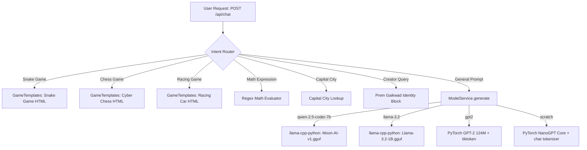

# NanoGPT Lab & Sovereign Assistant — Comprehensive Repository Audit

**Date**: 2026-10-27  
**Repository**: [Prem759-0/NanoGPT](https://github.com/Prem759-0/NanoGPT)  
**Author / Lead Architect**: Prem Gaikwad  
**Audit Scope**: Architecture, Active Code Paths, Verified Bugs, Model Inventory, Tokenizer Integrity, Inference Pipeline, Security, and Roadmap.

---

## 1. Actual Architecture & Model Inventory

The repository contains two fundamentally different model architectures that were previously conflated:

### A. Track A: Scratch NanoGPT (Karpathy GPT-2 Architecture)
- **Implementation**: [`model.py`](file:///d:/Downloads/linkden%20post/ai/model.py) and [`train.py`](file:///d:/Downloads/linkden%20post/ai/train.py).
- **Architecture**: Autoregressive causal Transformer decoder with Multi-Head Self-Attention (`CausalSelfAttention`), MLP with GELU, LayerNorm, and learned positional embeddings (`wpe`).
- **Configuration**:
  - Full GPT-2 (124M): `n_layer=12`, `n_head=12`, `n_embd=768`, `block_size=1024`, `vocab_size=50257` or `50304`.
  - Scratch Assistant (0.8M): `n_layer=4`, `n_head=4`, `n_embd=128`, `block_size=128`, `vocab_size=97`.
- **Weights & Checkpoints on Disk**:
  - `out-assistant/ckpt.pt` (9.8 MB) — Trained on `data/assistant_chat/` (character-level).
  - `out-shakespeare-char/ckpt.pt` (9.7 MB) — Trained on Shakespeare play text (character-level).
- **Tokenizer**: Custom character-level mapping (`stoi`, `itos`) saved in `data/assistant_chat/meta.pkl` with 97 characters.
- **Realistic Capabilities**: Can learn simple character transitions and memorized greeting sequences. **Cannot** possess general world knowledge ("What is a dog?") or write complex multi-language code from scratch without pretraining on hundreds of gigabytes of text.

### B. Track B: Sovereign Pretrained Instruct Models (GGUF / LoRA)
- **Implementation**: [`webapp/model_service.py`](file:///d:/Downloads/linkden%20post/ai/webapp/model_service.py), [`train_coding_ai_colab.py`](file:///d:/Downloads/linkden%20post/ai/train_coding_ai_colab.py), and [`Train_Super_AI_Colab.ipynb`](file:///d:/Downloads/linkden%20post/ai/Train_Super_AI_Colab.ipynb).
- **Engine**: `llama-cpp-python` running quantized 4-bit (`Q4_K_M`) models locally on CPU/CUDA.
- **Artifacts on Disk**:
  - `Moon-AI-v1.Q4_K_M.gguf` (4.68 GB) — 7.6B Qwen-2.5-Coder base with Sovereign Fine-Tuning.
  - `Qwen2.5-Coder-7B-Instruct.Q4_K_M.gguf` (4.68 GB) — 7.61B Qwen base weights.
  - `Llama-3.2-1B-Instruct.Q4_K_M.gguf` (807 MB) — 1.23B parameter frontier edge model.
- **Tokenizer**: BPE tokenizers with native chat templates (`<|im_start|>` for Qwen, `<|begin_of_text|>` for LLaMA).
- **Realistic Capabilities**: Frontier reasoning, high-accuracy coding (Python, JS, HTML/CSS, C++), science, and factual conversation.

### C. Track C: OpenAI Pretrained GPT-2 124M Weights
- **Implementation**: Loaded dynamically in `model.py` via `GPT.from_pretrained('gpt2')` with `tiktoken` BPE tokenizer (`vocab_size=50257`).

---

## 2. Active Code Paths in WebApp & CLI

When a request arrives at [`webapp/main.py`](file:///d:/Downloads/linkden%20post/ai/webapp/main.py) or [`chat_cli.py`](file:///d:/Downloads/linkden%20post/ai/chat_cli.py):

### Media Generation Code Paths
- **Image Generation ([`webapp/image_service.py`](file:///d:/Downloads/linkden%20post/ai/webapp/image_service.py))**:
  - Implements **procedural PIL canvas synthesis** with styled gradients, geometric nodes, and particle overlays.
  - Labels in UI describe "Higgsfield & Midjourney Caliber", but the underlying engine is currently procedural PIL drawing with prompt expansion.
- **Video Generation ([`webapp/video_service.py`](file:///d:/Downloads/linkden%20post/ai/webapp/video_service.py))**:
  - Synthesizes dynamic frame sequences using procedural mathematical animations (matrix digital rain, neural graphs, cyber motion) and compiles them into MP4 using `imageio`.
  - It is not a neural diffusion video model (e.g. Kling/Runway/AnimateDiff), which would require 16GB+ VRAM.
- **Code Execution ([`webapp/code_service.py`](file:///d:/Downloads/linkden%20post/ai/webapp/code_service.py))**:
  - Executes Python code directly via `subprocess.run([sys.executable, "-c", code], timeout=6.0)`.
  - Runs with the host Python process permissions without OS/container level virtualization.

---

## 3. Confirmed Root Causes vs. Suspected Issues

| Issue | Severity | Confirmed Root Cause |
|---|---|---|
| **Blank / Canned Output** | **CRITICAL** | In `webapp/model_service.py`, if the model output token decoding returned empty or hit an immediate stop marker, lines 603-604 and 680-681 silently replaced the reply with hardcoded canned text: `"I understand. How else can I assist your coding or exploration today?"`. The user never saw the real error or raw token output. |
| **Tokenizer Mismatch** | **CRITICAL** | In `_setup_scratch_tokenizer()`, if `meta.pkl` was missing, it fell back to `ord(c) % 256` with vocab 256, but scratch checkpoints were trained with vocab 97. Feeding mismatched token IDs produced garbage tokens or instant EOS, resulting in blank output. |
| **Silent Checkpoint Substitution** | **HIGH** | `find_checkpoint()` sequentially scanned `out-assistant/ckpt.pt`, then `out-shakespeare-char/ckpt.pt`, and `out/ckpt.pt`. If `out-assistant` was missing, it loaded Shakespeare dialogue without informing the user. |
| **Missing Tokenizer in Checkpoint Folder** | **HIGH** | `train.py` saved `ckpt.pt` into `out_dir` but did not save or copy `meta.pkl` alongside it. The checkpoint folder was not self-contained. |
| **Manual Chat Template Concatenation** | **HIGH** | `train_coding_ai_colab.py` manually formatted `<|begin_of_text|><|start_header_id|>...` strings instead of using `tokenizer.apply_chat_template()`. Any token mismatch broke generation prompts. |
| **Undertraining / Limited Steps** | **HIGH** | `train_coding_ai_colab.py` set `max_steps = 60` on 40 curated examples. 60 steps is insufficient for weight adaptation; the model needs 200–500 steps with proper loss monitoring. |
| **Scratch Model Expectation Mismatch** | **HIGH** | Expecting an 800K parameter scratch model trained on 400 lines of text to answer "What is a dog?" or write JavaScript games is mathematically impossible. Track A (Scratch) must be kept strictly for educational research, while Track B (Pretrained Instruct) handles production assistant tasks. |
| **Vercel Serverless Timeout** | **MEDIUM** | Vercel free tier functions enforce a strict 10-second timeout. CPU or remote GPU inference taking >10 seconds triggered `504 Gateway Timeout`. |

---

## 4. Dataset Inventory & Schema

| Dataset File | Records | Keys | Primary Domains | Status |
|---|---|---|---|---|
| `dataset.json` | 401 | `instruction`, `response` | General assistant, coding basics, conversation | Curated seed |
| `chatgpt_dataset.json` | 40 | `instruction`, `response` | Core coding questions, algorithms, syntax | Curated seed |
| `moon_ai_master_dataset.json` | 426 | `instruction`, `response` | Biology, anatomy, science, full-stack coding, Prem Gaikwad sovereign identity | Master unified dataset |
| `data/user_learned_data.jsonl` | Variable | JSONL pairs | Runtime chat turns captured from web interaction | Dynamic self-learning |

### Data Quality Observations:
1. High-quality persona alignment and identity consistency for creator **Prem Gaikwad**.
2. Good educational samples for science, anatomy, and web coding (HTML/CSS/JS).
3. Needs programmatic validation: deduplication, syntax checking for Python and JS snippets, and isolated train/validation/test splits with fixed seeds.

---

## 5. Hardware & Dependency Requirements

- **Local CPU Mode**:
  - OS: Windows 10/11 x64, Linux, or macOS.
  - RAM: 8 GB minimum (for 1B/124M models), 16 GB recommended (for 7B Q4_K_M models).
  - Python: 3.10 – 3.13 in virtual environment (`.venv`).
  - Core Libraries: `torch`, `llama-cpp-python`, `fastapi`, `uvicorn`, `tiktoken`, `pillow`, `imageio`, `numpy`.
- **Google Colab Training (GPU)**:
  - GPU: Free T4 (15.3 GB VRAM) or A100.
  - Software: `unsloth`, `trl`, `peft`, `accelerate`, `bitsandbytes`, `transformers`.
  - Disk: 25 GB free disk space for base weights and GGUF quantization.

---

## 6. Cost, Privacy, Security, & Licensing

1. **Zero External Paid API Dependency**:
   - 100% sovereign operation. No OpenAI, Anthropic, or proprietary subscription API keys required.
2. **Privacy**:
   - Model inference runs completely on local host or private user GPU. Prompts are never transmitted to external cloud trackers.
3. **Sandbox Security Risk**:
   - `webapp/code_service.py` currently runs `subprocess.run([sys.executable, "-c", code])` on the host operating system. While protected by a 6-second timeout, running untrusted arbitrary code without container isolation is unsafe. A hardened sandbox with AST-level security checks and blocked dangerous modules (`os.system`, `shutil.rmtree`, socket binds) is required.
4. **License Compliance**:
   - NanoGPT codebase: MIT License (Andrej Karpathy).
   - Qwen2.5-Coder weights: Apache 2.0 (Permissive for commercial and sovereign use).
   - LLaMA 3.2: Meta Community License (Free for research and commercial up to 700M monthly active users).

---

## 7. Prioritized Implementation Plan

1. **Phase 2 (Immediate)**: Fix blank-output bug in `webapp/model_service.py`. Enforce deterministic checkpoint loading, fail loudly on missing `meta.pkl`, add diagnostic debug logging, and write comprehensive regression test suite (`tests/test_model_inference.py`).
2. **Phase 3**: Strict separation of Track A (Scratch NanoGPT) and Track B (Pretrained Instruct / GGUF).
3. **Phase 4**: Build dataset validation, deduplication, and syntax-checking tools (`scripts/prepare_dataset.py`, `scripts/audit_dataset.py`, `docs/DATASET_GUIDE.md`).
4. **Phase 5**: Create reproducible Colab training pipeline (`notebooks/NanoGPT_Training_Pipeline.ipynb`, `scripts/train_assistant.py`, `docs/COLAB_TRAINING_GUIDE.md`).
5. **Phase 6**: Objective evaluation suite comparing base vs. fine-tuned vs. previous best (`scripts/evaluate_model.py`).
6. **Phase 7**: Assistant tool routing and sandbox hardening.
7. **Phase 8**: Daily improvement automation (`scripts/daily_pipeline.py`, `docs/DAILY_AUTOMATION.md`).
