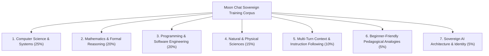
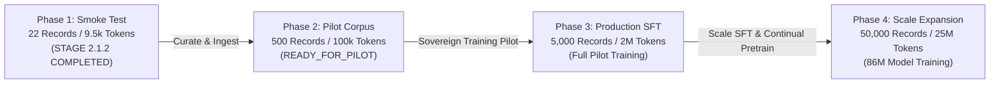

# Moon AI — Sovereign Conversational Data Acquisition Plan (Moon Chat v0)

**Author:** Prem Gaikwad (Chief ML Systems Architect, Moon AI, India 🇮🇳)  
**Ownership Policy:** `STRICT_SOVEREIGN_RANDOM_INIT_ONLY`  
**Target Tracks:** `moon-chat-v0` (25.7M Pilot & 86.1M Baseline)  
**Status:** **OPERATIONAL BLUEPRINT (STAGE 2.1.2)**  

---

## 1. Executive Summary & Core Mandate

Moon AI models are trained exclusively from random Gaussian weight initializations without third-party foundation checkpoints, external LLM distillation, LoRA adapters, or hosted inference APIs. 

Stage 2.1.1 and Stage 2.1.2 established a verified 22-record conversational corpus (9,445 tokens) that validates tokenizer mechanics, multi-window chunking, assistant-only loss masking, and training loop safety. However, **22 records are mathematically and empirically insufficient to train an intelligent general-purpose conversational language model**.

This document outlines the **Sovereign Data Acquisition Plan** to scale the Moon Chat corpus from 22 records to a high-quality, legally verified, and pedagogically rich training dataset across four operational phases without ever fabricating synthetic conversations or violating intellectual property boundaries.

---

## 2. Empirical Scaling Targets by Architecture

| Track | Architecture | Exact Parameters | Min. Smoke Test Data | Pilot SFT Requirement (`READY_FOR_PILOT`) | Production SFT Target | Full Pretraining Target |
|---|---|---|---|---|---|---|
| **Moon Chat Pilot** | 8L, 8H, 512D, block 512 | 25,698,816 ($25.7\text{M}$) | 10 records / 2k tokens *(Passed)* | **500 records / 100k tokens** | 5,000 records / 2M tokens | 25,000 records / 10M tokens |
| **Moon Chat Baseline** | 12L, 12H, 768D, block 1024 | 86,133,504 ($86.1\text{M}$) | 10 records / 2k tokens | 2,000 records / 500k tokens | 20,000 records / 10M tokens | 100,000 records / 50M tokens |
| **Moon Chat Target Scale** | 24L, 16H, 1024D, block 2048 | 312,000,000 ($312\text{M}$) | 10 records / 2k tokens | 10,000 records / 2.5M tokens | 100,000 records / 50M tokens | 500,000 records / 250M tokens |

> [!IMPORTANT]
> A 25.7M parameter model trained for 500 iterations on 18 conversations experiences over 880 epochs of repeated sample exposure, leading to catastrophic memorization rather than generalized dialogue capability. Meaningful training requires minimum threshold scale.

---

## 3. Curriculum & Domain Taxonomy

To ensure well-rounded dialogue and reasoning capabilities, data collection is structured across seven prioritized curriculum domains:



### Domain Specifications
1. **Computer Science & Systems (25%)**:
   - Algorithms (sorting, searching, graph traversal, dynamic programming).
   - Data structures (trees, hash tables, heaps, graphs, arrays, linked lists).
   - Operating systems (processes, threads, virtual memory, paging, filesystems, TOCTOU).
   - Distributed systems (CAP theorem, consensus, replication, RPC).
   - Networking & Cryptography (TCP/UDP, TLS, Ed25519, hashing).
2. **Mathematics & Formal Reasoning (20%)**:
   - Calculus, linear algebra, discrete mathematics, probability, statistics, formal logic (proof by contradiction, induction).
3. **Programming Fundamentals & Software Engineering (20%)**:
   - Python, C, Rust, Go fundamentals.
   - Clean architecture, SOLID principles, testing, debugging, complexity analysis.
4. **Natural & Physical Sciences (15%)**:
   - Physics (mechanics, thermodynamics, electromagnetism, relativity).
   - Chemistry & Molecular Biology (atomic structure, thermodynamics, DNA base pairing, genetics).
5. **Multi-Turn Context & Instruction Following (10%)**:
   - Formatted tables (Markdown, ASCII), JSON extraction, constrained writing, multi-turn clarification dialogues.
6. **Beginner-Friendly Pedagogical Analogies (5%)**:
   - Everyday analogies explaining technical abstractions (e.g. API as a restaurant waiter, DNS as a phonebook).
7. **Sovereign AI Architecture & Identity (5%)**:
   - First-principles random initialization, sovereign AI ownership, technical humility, transparent provenance.

---

## 4. Approved vs. Prohibited Sourcing Channels

### A. Approved Sourcing Channels
- **Channel A: Original Self-Authored Curricula (`ORIGINAL_SELF_AUTHORED_QA`)**:
  - Educational Q&A dialogues directly written by Prem Gaikwad and verified Moon AI contributors.
  - License: `CustomSovereign`.
- **Channel B: Open-Access Encyclopedic & Textbook Corpora (`SOURCE_DERIVED_EDUCATIONAL_SUMMARY`)**:
  - Synthesized and adapted from verifiable open-licensed sources:
    - **Wikipedia & Wikimedia**: Page title, stable revision snapshot permalink (`oldid`), and attribution to Wikipedia contributors under `CC-BY-SA-4.0`.
    - **OpenStax**: Open textbooks under `CC-BY-4.0`.
    - **Project Gutenberg**: Public domain educational classics (`Public Domain`).
  - Strict requirement: Page-specific licensing verification and explicit `is_modified: True` modification notice.
- **Channel C: Permissive Software Documentation (`SOURCE_DERIVED_EDUCATIONAL_SUMMARY`)**:
  - Python Software Foundation official documentation tutorials (`CC0-1.0` / PSF License).
  - GNU documentation, MIT/Apache-2.0 open-source educational manuals.
- **Channel D: Genuine Human Conversations (`GENUINE_HUMAN_CONVERSATION`)**:
  - Verifiable human-to-human or human-assistant conversation transcripts with documented consent and open permissive licenses.

### B. Strictly Prohibited Sourcing Channels (Zero-Tolerance)
> [!CAUTION]
> The following sources are strictly forbidden from entering any Moon AI manifest:
> 1. **Synthetic dialogues generated by external LLMs** (e.g. OpenAI GPT-4, Anthropic Claude, Meta LLaMA, Qwen, DeepSeek). Generating fabricated conversations to simulate volume violates sovereign ownership.
> 2. **Unattributed web scraping** without explicit open licensing.
> 3. **Copyrighted books, paywalled papers, or commercial courses**.
> 4. **Teacher-student knowledge distillation** or prompt-engineered pseudo-conversations.

---

## 5. Metadata Schema & Provenance Invariants

Every production record in `datasets/manifests/chat_*.jsonl` must strictly adhere to the schema enforced by `datasets/chat/schema.py`:

```json
{
  "id": "moon_chat_gen_003",
  "category": "computer_science",
  "source": "Wikipedia: Quicksort",
  "source_url": "https://en.wikipedia.org/wiki/Quicksort",
  "source_revision": "Wikipedia revision snapshot 2024 (verified under CC-BY-SA 4.0)",
  "license": "CC-BY-SA-4.0",
  "license_url": "https://creativecommons.org/licenses/by-sa/4.0/",
  "attribution": "Wikipedia contributors (licensed under CC-BY-SA 4.0)",
  "provenance_type": "SOURCE_DERIVED_EDUCATIONAL_SUMMARY",
  "is_modified": true,
  "modification_summary": "Encyclopedic sorting algorithm principles synthesized into multi-turn educational Q&A dialogue with complexity analysis.",
  "is_dev_fixture": false,
  "messages": [
    {"role": "user", "content": "Explain how the Quicksort algorithm works..."},
    {"role": "assistant", "content": "Quicksort is a divide-and-conquer sorting algorithm..."}
  ],
  "sha256": "430fe9b407a514d3aeb482a22956cf55169a838562d2d93e155bc7c5bca949be"
}
```

### Key Invariants:
1. **Missing provenance never defaults to genuine data**: Any record lacking `provenance_type` fails closed.
2. **Missing attribution never falls back to source title**: Records must explicitly declare who authored or contributed the text.
3. **Content-integrity hash separated from provenance**: Canonical SHA-256 verifies that text bytes have not mutated, while provenance metadata establishes legal and architectural authenticity.

---

## 6. Phased Scaling Roadmap



- **Phase 1 (Completed — Stage 2.1.2)**: 22 authentic records across 11 domains. Multi-window chunking, assistant-only loss masking, and training loop safety verified. Status: `ENGINEERING_SMOKE_TEST_ONLY`.
- **Phase 2 (Next Milestone — Target: Stage 2.2)**: Curate 500 verified records (100,000+ tokens) across Wikipedia educational summaries (300 records), PSF tutorials (100 records), and original self-authored dialogues (100 records). Unlocks `READY_FOR_PILOT`.
- **Phase 3 (Pilot Execution)**: Execute 500-iteration training on Google Colab NVIDIA T4 with micro-batch 4 and gradient accumulation 8. Produce signed evaluation attestation.
- **Phase 4 (Baseline Scale)**: Expand to 50,000 records for the 86.1M model track.

---

## 7. Storage, Deduplication & Validation Pipeline

1. **Ingestion**: Curated JSON records pass through `datasets/chat/curator.py`.
2. **Deduplication**: Exact duplicate SHA-256 hashes and normalized user prompt strings are rejected.
3. **Partitioning**: Deterministic 80/10/10 split into `chat_train.jsonl`, `chat_val.jsonl`, and `chat_test.jsonl`.
4. **Leakage Verification**: Hash intersection of all splits must be exactly empty ($0$).
5. **Tokenizer Training**: Pure byte-level BPE retrained from scratch on updated corpus.
6. **Readiness Evaluation**: `training/chat/readiness_gate.py` evaluates all 10 criteria before any training run is permitted.

