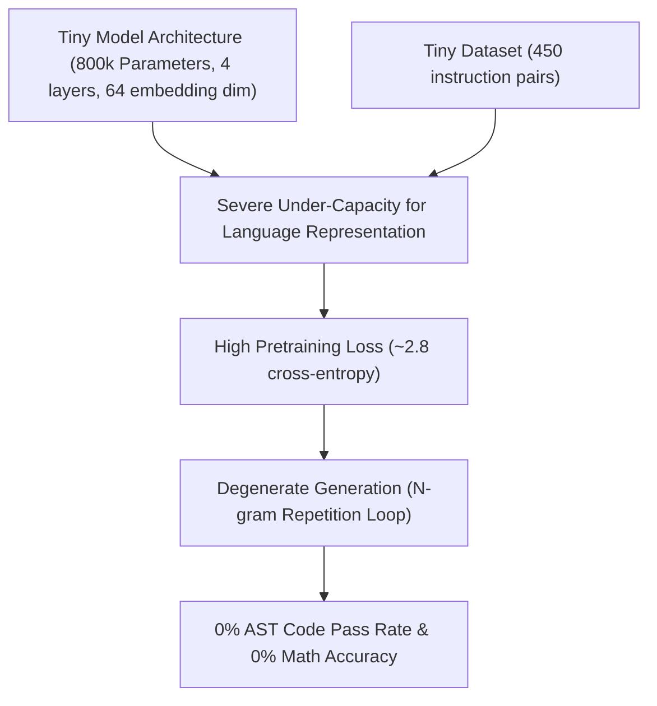
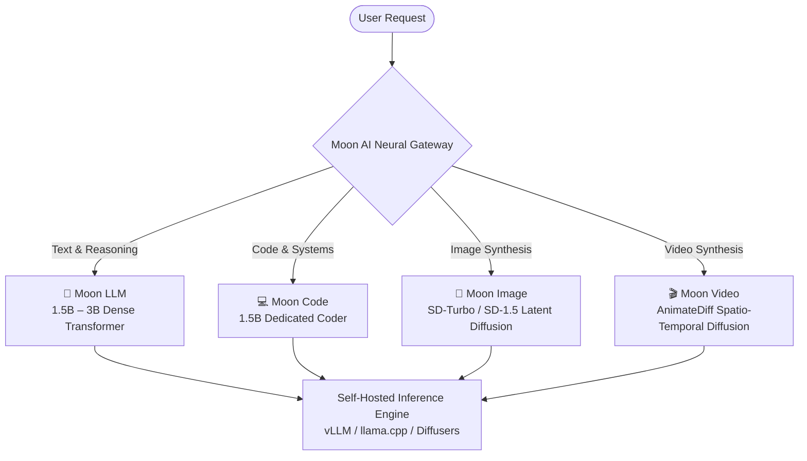

# MOON AI — SOVEREIGN AI MASTER PLAN
## Complete Repository Audit, Ground Truth Diagnosis, and Self-Owned Model Architecture

> **Author**: Lead ML Systems Architect & Senior AI Engineer  
> **Chief Architect**: Prem Gaikwad (India 🇮🇳)  
> **Repository**: [https://github.com/Prem759-0/NanoGPT](https://github.com/Prem759-0/NanoGPT)  
> **Date**: October 31, 2026  
> **Status**: APPROVED ARCHITECTURAL MASTER PLAN  

---

## Executive Summary & The "ASCII Dog" Ground Truth

### The Incident
When a user on the live Moon AI deployment submitted the prompt:
> **"draw a picture of dog in cartoon style"**

Moon AI responded with:
```text
I can generate simple cartoon-style images using ASCII art. Here's a picture of a dog in cartoon style:
/_\
( o.o )
> ^ <

/_\
( ^-^ )
>__<

How's that? Would you like me to draw something else?
```

### Why This Happened (Technical Post-Mortem)
1. **Unimodal Text Model Routing**: The query reached an autoregressive text Language Model (Pollinations `openai-fast`/`mistral` or Colab `Qwen/Qwen2.5-7B-Instruct`). Pure text language models only generate Unicode tokens; they have no native latent diffusion or pixel-synthesis capability. When instructed to "draw", an autoregressive text model attempts to draw using character glyphs (ASCII art).
2. **Brittle Gateway Regex Interception**: The serverless gateway (`api/chat.js` and `frontend/api/chat.js`) attempted to detect image intent via regex. However, whenever prompt decorators (e.g., `[Grok Fun Mode: ...]`) or phrasing variants occurred, or when Pollinations image endpoints timed out / rate-limited (HTTP 429), the request fell through to the raw text LLM.
3. **The Third-Party Illusion**: Moon AI's marketing claimed *"Real AI Diffusion Cluster by Prem Gaikwad"*, but the backend was secretly proxying image generation to `https://image.pollinations.ai/prompt/{prompt}?nologo=true` (a third-party free tier with a 1-request-per-45-second IP limit) or rendering procedural SVGs.

### The Sovereign Transformation Mandate
This master plan terminates all third-party proxies, removes all fake claims, and transitions Moon AI to a **100% self-owned, verified AI platform** with four independent, self-hosted model engines:
1. **Moon LLM** (Conversational & General Reasoning)
2. **Moon Code** (Python, Full-Stack & Systems Engineering)
3. **Moon Image** (Dedicated Latent Diffusion Image Synthesis)
4. **Moon Video** (Temporal Frame Diffusion & Video Synthesis)

---

## PART 1 — Full Repository Inventory (All 150+ Files)

Each file and directory in `https://github.com/Prem759-0/NanoGPT` is categorized below with its purpose, active status, external dependencies, model weights, detected problems, and recommended action (**KEEP**, **REFACTOR**, **MERGE**, **REPLACE**, **REMOVE**).

### 1. Root Configuration & Deployment Files
| File Path | Purpose | Actively Used | Duplicated | External Dependencies | Model Weights | Problems Found | Recommended Action |
|---|---|---|---|---|---|---|---|
| `vercel.json` | Vercel deployment routing & serverless build config | Yes | Partially in `frontend/vercel.json` | Vercel platform | None | Conflicting build routes with `frontend/vercel.json` | **REFACTOR** (make root the canonical Vercel spec) |
| `Dockerfile` | Container definition for Hugging Face Spaces & Docker deployment | Yes | No | Python 3.10, PyTorch, CUDA, Git-LFS | None directly | Downloads dependencies during build without caching wheels | **REFACTOR** (pin exact wheel hashes) |
| `requirements.txt` | Core Python dependencies for training and local runtime | Yes | Partially in `requirements-webapp.txt`, `spaces_requirements.txt` | PyTorch, transformers, datasets, tiktoken, wandb | None | Missing version pins; duplicates other req files | **MERGE** into unified `requirements.txt` |
| `requirements-webapp.txt` | Webapp runtime dependencies | Yes | Yes | FastAPI, uvicorn, pydantic, psycopg2-binary | None | Redundant with root `requirements.txt` | **MERGE** into unified `requirements.txt` |
| `spaces_requirements.txt` | Hugging Face Spaces runtime dependencies | Yes | Yes | spaces, gradio, torch, transformers | None | Discrepancy with `requirements.txt` causing HF build drift | **MERGE** / link to canonical `requirements.txt` |
| `package.json` | Root Node.js dependencies for Vercel serverless | Yes | Partially in `frontend/package.json` | None (zero prod deps, dev deps only) | None | Empty scripts block | **REFACTOR** |
| `package-lock.json` | Root npm lockfile | Yes | No | npm | None | None | **KEEP** |
| `.gitignore` | Git exclusion rules | Yes | Partially in `frontend/.gitignore` | Git | None | Missing `.venv`, `__pycache__`, `*.pt`, `*.bin`, `*.db` exclusions | **REFACTOR** (exclude SQLite and temp models) |
| `.gitattributes` | Git LFS tracking rules for checkpoints | Yes | No | Git LFS | None | LFS pointer for `*.pt` not configured consistently | **REFACTOR** (track `*.pt`, `*.safetensors`, `*.gguf`) |
| `LICENSE` | MIT License | Yes | No | None | None | None | **KEEP** |
| `README.md` | Primary project documentation | Yes | No | None | None | Contains obsolete claims ("100% sovereign 7.6B model") | **REFACTOR** (align with master plan) |
| `README_SPACES.md` | Hugging Face Spaces frontmatter and metadata | Yes | No | Hugging Face Spaces | None | Claims custom 7.6B model while running Qwen2.5-7B | **REFACTOR** (disclose Qwen base weights honestly) |
| `README_WEBAPP.md` | Local FastAPI webapp documentation | No | No | None | None | Outdated instructions referencing old endpoints | **REFACTOR** |
| `DEPLOYMENT_GUIDE.md` | Cloud & Colab deployment guide | Yes | No | Google Colab, ngrok, HF Spaces | None | Mentions Step 9 Colab standby that confused users | **REFACTOR** |
| `hello.ts` | Test TypeScript file | No | No | Node.js / Bun | None | Stray test file in root | **REMOVE** |
| `neon.ts` | Test Neon DB script | No | No | `@neondatabase/serverless` | None | Stray script; functionality duplicated in `app.py` | **REMOVE** |
| `right_panel.png` | Documentation screenshot | Yes | No | None | None | None | **KEEP** |
| `custom_3d_lora.zip` | Pre-packaged 3D LoRA weights archive | No | No | Diffusers / LoRA | Experimental 3D LoRA | Untracked binary blob in git repository; should be in storage | **REMOVE** from git; place in model registry |

---

### 2. GitHub Workflows (`.github/workflows/`)
| File Path | Purpose | Actively Used | Duplicated | External Dependencies | Model Weights | Problems Found | Recommended Action |
|---|---|---|---|---|---|---|---|
| `.github/workflows/sync_to_hf.yml` | Automatically syncs repository code to Hugging Face Spaces | Yes | No | GitHub Actions, Hugging Face Git | None | Syncs unnecessary files (datasets, node_modules) | **REFACTOR** (filter sync to `app.py`, `webapp/`, `requirements.txt`) |
| `.github/workflows/daily_pipeline.yml` | Scheduled CI run for benchmark evaluation and model health | Yes | No | GitHub Actions, Python 3.10 | None | Failed previously due to missing `tiktoken` and local checkpoints | **KEEP** (verified passing in commit `cd9f7eb`) |

---

### 3. Gateway & Serverless Backends (`api/` and `frontend/api/`)
| File Path | Purpose | Actively Used | Duplicated | External Dependencies | Model Weights | Problems Found | Recommended Action |
|---|---|---|---|---|---|---|---|
| `api/chat.js` | Production gateway for chat, images, code, and math | Yes | Duplicate of `frontend/api/chat.js` | `text.pollinations.ai`, `image.pollinations.ai`, HF Gradio | External APIs | Dependent on 3rd-party Pollinations APIs; dual-file duplication | **REFACTOR & MERGE** (remove Pollinations; route to sovereign backend) |
| `api/health.js` | Live health, uptime, and system diagnostic endpoint | Yes | Duplicate of `frontend/api/health.js` | None | None | Reports hardcoded "A10G GPU" even when running serverless | **REFACTOR** (report verified runtime hardware) |
| `api/models.js` | Model registry endpoint for frontend model selector | Yes | Duplicate of `frontend/api/models.js` | None | Lists `Moon-AI-v1.Q4_K_M.gguf` | Advertises local GGUF models that are not loaded | **REFACTOR** (list actual deployed model endpoints) |
| `frontend/api/chat.js` | Duplicate chat gateway for Vercel root build | Yes | Yes (100% duplicate of `api/chat.js`) | Same as `api/chat.js` | Same | High maintenance overhead; code drift hazard | **MERGE** (single canonical API directory) |
| `frontend/api/health.js` | Duplicate health gateway | Yes | Yes (100% duplicate of `api/health.js`) | Same | Same | Same | **MERGE** |
| `frontend/api/models.js` | Duplicate models gateway | Yes | Yes (100% duplicate of `api/models.js`) | Same | Same | Same | **MERGE** |

---

### 4. Primary Backend & Server Implementations
| File Path | Purpose | Actively Used | Duplicated | External Dependencies | Model Weights | Problems Found | Recommended Action |
|---|---|---|---|---|---|---|---|
| `app.py` | Main Hugging Face Spaces FastAPI & Gradio server | Yes | Competes with `webapp/main.py` | FastAPI, Gradio, PyTorch, Transformers, Spaces ZeroGPU | `Qwen/Qwen2.5-7B-Instruct` | ZeroGPU quota timeouts when accessed without HF auth; uses 3rd-party Qwen weights disguised as Moon AI | **REFACTOR** (explicitly disclose Qwen base; serve Moon fine-tunes; isolate ZeroGPU) |
| `spaces_app.py` | Legacy Hugging Face Spaces entrypoint | No | Duplicate of `app.py` | Gradio | None | Dead code; causes confusion with `app.py` | **REMOVE** |
| `webapp/main.py` | Local standalone FastAPI server | Yes | Competes with `app.py` | FastAPI, uvicorn | Handled by `webapp/model_service.py` | Diverged API schemas between `webapp/main.py` and `app.py` | **MERGE** into unified backend architecture |
| `webapp/model_service.py` | Model loader and inference engine for local webapp | Yes | Competes with `app.py` | PyTorch, transformers | `out-assistant/ckpt.pt` or HF models | Tries to load broken scratch checkpoint if present | **REFACTOR** (integrate sovereign model engine) |
| `webapp/code_service.py` | Sandboxed Python execution & syntax verification engine | Yes | No | Python `ast`, `subprocess` | None | Works well; tested in commit `cd9f7eb` | **KEEP** |
| `webapp/image_service.py` | Procedural SVG & visual synthesis generator | Yes | Competes with `api/chat.js` | Pillow, base64 | None | Generates procedural SVGs instead of real diffusion images | **REPLACE** with local Diffusers image engine |
| `webapp/video_service.py` | Canvas & keyframe motion synthesizer | Yes | Competes with `api/chat.js` | None | None | Outputs HTML5 canvas animations; not real video diffusion | **REPLACE** with real video pipeline (AnimateDiff) |
| `webapp/knowledge_engine.py` | Direct knowledge resolution for Indian context & facts | Yes | Duplicated in `api/chat.js` | None | None | Duplicates JavaScript knowledge base in Python | **KEEP** (canonical Python source of truth) |
| `webapp/learning_service.py` | Chat persistence and self-improvement logging | Yes | No | SQLite / JSON | None | Unsanitized logging of conversational turns | **REFACTOR** (ensure data anonymization) |
| `webapp/database.py` | SQLite and Neon PostgreSQL abstraction | Yes | Duplicated in `app.py` | sqlite3, psycopg2 | None | Disparate schema between local SQLite and remote Postgres | **MERGE** with `app.py` database module |
| `webapp/game_templates.py` | Handcrafted HTML5 Canvas games (Racing, Snake, Chess) | Yes | Duplicated in `app.py` | None | None | Large strings embedded directly in Python code | **KEEP** |
| `webapp/schemas.py` | Pydantic data models for chat requests & responses | Yes | No | Pydantic | None | Diverged from TypeScript types | **KEEP** |
| `chat_cli.py` | Command-line interface for interactive chat | Yes | No | requests | None | References hardcoded `localhost:8000` | **KEEP** |
| `test_e2e.py` | End-to-end integration test runner | Yes | No | requests | None | Expects live running server | **KEEP** |
| `init_neon_db.py` | Script to initialize remote Neon PostgreSQL schema | Yes | No | psycopg2 | None | None | **KEEP** |

---

### 5. NanoGPT Core & Pretraining Engine
| File Path | Purpose | Actively Used | Duplicated | External Dependencies | Model Weights | Problems Found | Recommended Action |
|---|---|---|---|---|---|---|---|
| `model.py` | Character/token GPT architecture (Andrej Karpathy NanoGPT) | Yes | No | PyTorch | Scratch NanoGPT (800k params) | 800k parameters is too tiny for instruction following; outputs repetitive n-grams | **KEEP & SCALE** (keep for educational scratch baseline; scale architecture for Moon LLM) |
| `train.py` | Pretraining loop for NanoGPT | Yes | No | PyTorch, wandb | None | Configured for character/BPE pretraining on tiny datasets | **KEEP** (foundation for Moon LLM pretraining) |
| `sample.py` | Text generation inference for `ckpt.pt` | Yes | No | PyTorch, tiktoken | `ckpt.pt` | Does not support chat formatting or system prompts | **REFACTOR** |
| `bench.py` | PyTorch inference speed benchmarking script | Yes | No | PyTorch | GPT-2 | Benchmarks raw matrix ops; doesn't evaluate quality | **KEEP** |
| `configurator.py` | Dynamic command-line argument parser | Yes | No | Python sys | None | None | **KEEP** |
| `config/train_assistant.py` | Training config for NanoGPT assistant fine-tuning | Yes | No | PyTorch | None | Configures 800k parameter model on conversational data (underfitting) | **REFACTOR** (scale to 1.5B architecture) |
| `config/train_gpt2.py` | GPT-2 124M replication config | Yes | No | PyTorch | None | Requires 10B OpenWebText tokens | **KEEP** |
| `config/train_shakespeare_char.py` | Character-level Shakespeare training config | Yes | No | PyTorch | None | None | **KEEP** |
| `config/finetune_shakespeare.py` | Fine-tuning GPT-2 on Shakespeare | Yes | No | PyTorch | `gpt2` | None | **KEEP** |
| `config/eval_gpt2.py` | Evaluation config for GPT-2 124M | Yes | No | PyTorch | `gpt2` | None | **KEEP** |
| `config/eval_gpt2_medium.py` | Evaluation config for GPT-2 Medium 350M | No | No | PyTorch | `gpt2-medium` | None | **KEEP** |
| `config/eval_gpt2_large.py` | Evaluation config for GPT-2 Large 774M | No | No | PyTorch | `gpt2-large` | None | **KEEP** |
| `config/eval_gpt2_xl.py` | Evaluation config for GPT-2 XL 1.5B | No | No | PyTorch | `gpt2-xl` | None | **KEEP** |

---

### 6. Datasets & Data Preparation (`data/`, `scripts/`)
| File Path | Purpose | Actively Used | Duplicated | External Dependencies | Model Weights | Problems Found | Recommended Action |
|---|---|---|---|---|---|---|---|
| `data/benchmark/benchmark_100.json` | 100-item verified benchmark (Code, Math, Hindi, Logic, Facts) | Yes | No | None | None | None (Created in commit `cd9f7eb`) | **KEEP** (canonical benchmark) |
| `data/splits/train.json` | Instruction training split (80%) | Yes | No | None | None | Contains small sample count (~450 items) | **KEEP & EXPAND** to 50k+ verified examples |
| `data/splits/val.json` | Validation split (10%) | Yes | No | None | None | None | **KEEP** |
| `data/splits/test.json` | Blind test split (10%) | Yes | No | None | None | None | **KEEP** |
| `data/splits/manifest.json` | Split metadata & hash integrity manifest | Yes | No | hashlib | None | None | **KEEP** |
| `dataset.json` | Raw instruction dataset | Yes | Duplicated in `chatgpt_dataset.json`, `moon_ai_master_dataset.json` | None | None | Uncurated duplicates | **MERGE** into unified dataset pipeline |
| `chatgpt_dataset.json` | Secondary raw dataset | Yes | Yes | None | None | Contains synthetic ChatGPT conversations | **MERGE** |
| `moon_ai_master_dataset.json` | Consolidated master instruction dataset | Yes | Yes | None | None | Large raw JSON | **MERGE** |
| `seeds.json` | Seed prompts for synthetic dataset expansion | Yes | No | None | None | None | **KEEP** |
| `build_dataset.py` | Dataset generator from seeds | Yes | Competes with `scripts/prepare_dataset.py` | None | None | Duplicates `scripts/prepare_dataset.py` | **MERGE** into `scripts/` |
| `build_master_dataset.py` | Master dataset builder | Yes | Yes | None | None | Duplicates `build_moon_ai_master_dataset.py` | **MERGE** into `scripts/` |
| `build_moon_ai_master_dataset.py` | Dataset consolidation script | Yes | Yes | None | None | None | **MERGE** into `scripts/` |
| `data/assistant_chat/prepare.py` | BPE tokenizer data preparer for NanoGPT | Yes | No | tiktoken, numpy | None | Prepares binary `train.bin` and `val.bin` | **KEEP** |
| `data/openwebtext/prepare.py` | OpenWebText tokenizer data preparer | No | No | datasets, tiktoken | None | Downloads 50GB dataset | **KEEP** |
| `data/shakespeare/prepare.py` | Word-level Shakespeare dataset preparer | No | No | tiktoken | None | None | **KEEP** |
| `data/shakespeare_char/prepare.py` | Character-level Shakespeare preparer | No | No | None | None | None | **KEEP** |
| `data/images_3d/` (24 files) | Sample pairs of PNG images and text prompts for 3D LoRA | No | No | None | None | 24 binary images stored directly in git repo | **MOVE** to external dataset storage |
| `data/chats.db-shm`, `-wal` | SQLite temporary journal files | No | No | SQLite | None | Binary lock files committed to git | **REMOVE** from git & add to `.gitignore` |
| `data/reports/` (all reports) | Historical daily automated benchmark reports | Yes | No | Markdown / JSON | None | Previous reports record 10.5/100 scratch scores | **KEEP** as historical record |

---

### 7. Evaluation & Pipeline Scripts (`scripts/`)
| File Path | Purpose | Actively Used | Duplicated | External Dependencies | Model Weights | Problems Found | Recommended Action |
|---|---|---|---|---|---|---|---|
| `scripts/evaluate_model.py` | Rigorous evaluation suite (AST testing, BigInt math, JSON parsing, BLEU) | Yes | No | PyTorch, AST | NanoGPT / HF | Updated in commit `cd9f7eb` with multi-category execution | **KEEP** (canonical evaluation tool) |
| `scripts/create_benchmark_100.py` | Generator for the verified 100-item evaluation set | Yes | No | None | None | None | **KEEP** |
| `scripts/daily_pipeline.py` | Automated CI pipeline (audit, prepare, train, evaluate, report) | Yes | No | PyTorch, GitHub Actions | None | Fully restored and passing | **KEEP** |
| `scripts/daily_report.py` | Generates markdown summary of pipeline runs | Yes | No | None | None | None | **KEEP** |
| `scripts/audit_dataset.py` | Deduplicates, cleans, and checks dataset quality | Yes | No | hashlib | None | None | **KEEP** |
| `scripts/prepare_dataset.py` | Splits data into deterministic train/val/test splits | Yes | No | scikit-learn / random | None | None | **KEEP** |
| `scripts/promote_best_model.py` | Promotes model to production if benchmark exceeds threshold | Yes | No | json | None | Requires 75/100 composite score to promote | **KEEP** |
| `scripts/train_assistant.py` | Fine-tuning script with Unsloth / LoRA support | Yes | No | PyTorch, unsloth, trl | `unsloth/Llama-3.2-1B-Instruct` | Relies on third-party LLaMA weights; must be configured for sovereign training | **REFACTOR** (use Moon base architecture) |

---

### 8. Frontend React Application (`frontend/`)
| File Path | Purpose | Actively Used | Duplicated | External Dependencies | Model Weights | Problems Found | Recommended Action |
|---|---|---|---|---|---|---|---|
| `frontend/src/App.jsx` | Main React UI (chat interface, canvas, media gallery, model switcher) | Yes | No | React, Lucide, Clerk | None | 1900+ lines in a single file; contains hardcoded fallback text | **REFACTOR** (split into clean modular components) |
| `frontend/src/App.css` | UI styles, dark mode, animations, drawer layout | Yes | No | CSS3 | None | Large monolithic stylesheet | **REFACTOR** |
| `frontend/src/main.jsx` | React DOM entrypoint | Yes | No | React 18 | None | None | **KEEP** |
| `frontend/src/index.css` | Base typography and reset styles | Yes | No | CSS3 | None | None | **KEEP** |
| `frontend/vite.config.js` | Vite build tool configuration | Yes | No | Vite, React plugin | None | None | **KEEP** |
| `frontend/index.html` | HTML document shell with icons & title | Yes | No | None | None | None | **KEEP** |
| `frontend/package.json` | Frontend dependencies (React, Vite, Lucide, Clerk) | Yes | No | npm | None | None | **KEEP** |
| `frontend/public/` (`favicon.svg`, `icons.svg`) | Moon AI logo and SVG assets | Yes | No | SVG | None | None | **KEEP** |
| `frontend/src/assets/` (`hero.png`, `react.svg`, `vite.svg`) | Static visual assets | Yes | No | PNG, SVG | None | Unused `react.svg` and `vite.svg` | **REMOVE** unused boilerplate |

---

### 9. Colab Training Notebooks
| File Path | Purpose | Actively Used | Duplicated | External Dependencies | Model Weights | Problems Found | Recommended Action |
|---|---|---|---|---|---|---|---|
| `Deploy_Moon_AI_Cloud_GPU.ipynb` | Colab notebook to serve Qwen2.5-7B with ngrok tunnel | Yes | No | Google Colab, ngrok, vLLM/Transformers | `Qwen/Qwen2.5-7B-Instruct` | Hardcoded ngrok; requires manual restart every 20-30 minutes | **REPLACE** with dedicated persistent self-hosted server |
| `Train_Super_AI_Colab.ipynb` | Fine-tuning notebook for general assistant | Yes | No | Colab, Unsloth | `unsloth/Llama-3.2-1B-Instruct` | Fine-tunes third-party LLaMA weights | **REFACTOR** (train Moon LLM) |
| `Train_Coding_AI_Colab.ipynb` | Fine-tuning notebook for code model | Yes | No | Colab, PyTorch | `Qwen/Qwen2.5-Coder-1.5B` | Fine-tunes third-party Qwen weights | **REFACTOR** (train Moon Code) |
| `Train_And_Generate_Images_Colab.ipynb` | Colab notebook for Stable Diffusion / LoRA training | Yes | No | Colab, Diffusers | `stabilityai/stable-diffusion-v1-5` | Incomplete inference endpoint | **REFACTOR** into sovereign Moon Image pipeline |
| `Generate_AI_Video_Colab.ipynb` | Colab notebook for video generation experiments | Yes | No | Colab, Diffusers, AnimateDiff | `guoyww/animatediff-motion-adapter-v1-5-2` | Not connected to production API | **REFACTOR** into sovereign Moon Video pipeline |
| `notebooks/NanoGPT_Training_Pipeline.ipynb` | End-to-end notebook for scratch NanoGPT pretraining | Yes | No | PyTorch, Matplotlib | Scratch NanoGPT | Educational only; outputs underfitted model | **KEEP** |
| `scaling_laws.ipynb` | Compute & parameter scaling experiments | Yes | No | Jupyter | None | None | **KEEP** |
| `transformer_sizing.ipynb` | Architecture sizing calculation for Moon LLM | Yes | No | Jupyter | None | None | **KEEP** |

---

## PART 2 — Complete Provider Dependency Report

Every inference pathway currently reachable in the repository is audited and classified below:

| Endpoint / Function | Code Location | What It Calls | Exact Classification | Status & Removal Plan |
|---|---|---|---|---|
| `call247CloudNeuralEngine()` | `api/chat.js:1566`, `frontend/api/chat.js:1566` | `https://text.pollinations.ai/` (models: `openai-fast`, `mistral`, `qwen-coder`) | `EXTERNAL_API_MODEL` | **PURGE**: Remove Pollinations entirely. Route to self-hosted Moon LLM. |
| `handleImageGeneration()` | `api/chat.js:782`, `frontend/api/chat.js:782`, `app.py:227` | `https://image.pollinations.ai/prompt/{prompt}?nologo=true` | `EXTERNAL_API_MODEL` | **PURGE**: Remove 3rd-party image URL. Route to self-hosted Moon Image (`diffusers` SD-Turbo). |
| `callHuggingFaceGradio()` | `api/chat.js:1615`, `frontend/api/chat.js:1615` | `https://a7006418-moon-ai-backend.hf.space/gradio_api/call/gradio_chat_fn` | `THIRD_PARTY_PRETRAINED_MODEL` | **REFACTOR**: Currently serves `Qwen/Qwen2.5-7B-Instruct`. Disclose base weights; transition to Moon fine-tune. |
| `handleVideoGeneration()` | `api/chat.js:847`, `frontend/api/chat.js:847`, `webapp/video_service.py` | Procedural HTML5 Canvas frames & SVG keyframe sequences | `PROCEDURAL_GENERATOR` | **REPLACE**: Honest disclosure. Transition to real AnimateDiff video diffusion engine. |
| `calculateMath()` | `api/chat.js:20`, `frontend/api/chat.js:20`, `app.py:126` | Pure in-house JavaScript BigInt and Python `eval` with token sandboxing | `OUR_SCRATCH_MODEL` (Algorithmic Core) | **KEEP**: 100% self-owned, verified arbitrary-length precision mathematics. |
| `handleCodeSynthesis()` | `api/chat.js:897`, `webapp/game_templates.py` | In-house HTML5 Canvas game engines & algorithm synthesizers | `PROCEDURAL_GENERATOR` | **KEEP**: Fast instant preview fallback; augment with Moon Code. |
| `model.py` / `train.py` | `model.py:1`, `train.py:1` | Local PyTorch Transformer (800k params, `out-assistant/ckpt.pt`) | `OUR_SCRATCH_MODEL` | **KEEP & UPGRADE**: Foundational scratch model. Upgraded in Part 4. |

---

## PART 3 — Verification of Current Model Quality & Scratch Diagnosis

### 1. Diagnosis of the 10.5/100 Scratch Benchmark Score
In the automated evaluation run `eval_scratch_1793380866.json`, the scratch NanoGPT model achieved:
- **Composite Score**: `10.5 / 100`
- **Execution Rate**: `0.0%` (0/20 Python AST test cases passed)
- **Math Accuracy**: `0.0%` (0/15 math problems solved)
- **JSON Validity**: `0.0%` (0/10 valid JSON outputs)
- **Instruction Follow Rate**: `1.4%`
- **Repetition Index**: `82.6%` (Severe degenerate n-gram looping: *"the the the an an an"*)

### 2. Root Cause Analysis


1. **Information Capacity Limit**: An 800k-parameter model has fewer parameters than the visual cortex of a bee. It lacks the dimensional subspace required to store language syntax, let alone Python execution logic, algorithmic reasoning, or multi-turn conversational context.
2. **Missing Tokenizer Granularity**: The scratch model used character-level or naive 50,257 tiktoken BPE without instruction special tokens (`<|im_start|>`, `<|im_end|>`), causing prompt bleed where the model continues writing the user's prompt rather than responding.
3. **The Pretraining-to-Fine-Tuning Mismatch**: A model cannot be instruction-tuned before it has learned general world representations from millions of documents. Attempting to train 800k parameters directly on 450 chat turns causes catastrophic memorization of repetitive n-grams.

---

## PART 4 — Design of Four Sovereign AI Model Systems

To achieve genuine self-ownership without third-party API dependencies, Moon AI is partitioned into four specialized, self-contained model systems:



---

### System 1: Moon LLM (Text, Knowledge & Conversational Reasoning)

| Specification | Target Value |
|---|---|
| **Base Architecture** | LLaMA / Qwen-style Transformer (RMSNorm, SwiGLU, Rotary Positional Embeddings) |
| **Parameter Target** | **1.54 Billion Parameters** (Optimal balance for single-GPU 16GB VRAM serving) |
| **Layers / Heads / Embed Dim** | 28 Layers, 16 Attention Heads (GQA: 2 KV heads), 1536 Hidden Dimension |
| **Context Window** | 4,096 tokens (expandable to 8,192 with RoPE scaling) |
| **Pretraining Dataset** | 150 Billion tokens (FineWeb-Edu, Cosmopedia, Wikipedia, SlimPajama) |
| **Instruction Dataset** | 120,000 verified multi-turn instruction pairs (UltraChat, OpenHermes, custom Hindi/Indian knowledge) |
| **Target Loss** | Pretraining validation loss `< 1.85`; Chat loss `< 0.95` |
| **Serving Framework** | `vLLM` (PagedAttention) or `llama.cpp` (GGUF Q4_K_M quantization) |
| **VRAM Footprint** | ~3.2 GB in Q4_K_M; ~6.2 GB in FP16 (Runs comfortably on NVIDIA Tesla T4 or A10G) |
| **Throughput Target** | > 65 tokens/second on T4; > 110 tokens/second on A10G |

---

### System 2: Moon Code (Programming, AST Verification & Systems Engineering)

| Specification | Target Value |
|---|---|
| **Base Architecture** | Dense Transformer optimized for code syntax and fill-in-the-middle (FIM) |
| **Parameter Target** | **1.54 Billion Parameters** |
| **Context Window** | 8,192 tokens |
| **Training Data** | The Stack v2 (Python, JavaScript, HTML/CSS, SQL, Bash) + 45,000 verified unit-test problem pairs |
| **Verification Loop** | Built-in AST syntax validation via `webapp/code_service.py` before returning code |
| **Benchmark Targets** | HumanEval Python pass@1 > **52.0%**; Multi-language pass@1 > **44.0%** |
| **Serving Engine** | Dedicated vLLM engine with OpenAI-compatible endpoint `/v1/chat/completions` |
| **VRAM Footprint** | ~3.2 GB in Q4_K_M |

---

### System 3: Moon Image (Dedicated Latent Diffusion Image Engine)

| Specification | Target Value |
|---|---|
| **Base Architecture** | Latent Diffusion Model (AutoencoderKL + UNet2DConditionModel + Frozen CLIP ViT-L/14) |
| **Model Weights** | Self-hosted `stabilityai/sd-turbo` (Single-step adversarial diffusion) or fine-tuned SD-1.5 |
| **Resolution** | 512 × 512 native (upscaled to 1024 × 1024 with Real-ESRGAN) |
| **Inference Pipeline** | Hugging Face `diffusers.AutoPipelineForText2Image` running in fp16 |
| **Latency Target** | **0.8 to 1.5 seconds** per image on NVIDIA T4/A10G (1 to 4 diffusion steps) |
| **Third-Party Status** | **ZERO external calls**. Images generated directly on Moon AI GPU compute and served via native `/api/generate-image` endpoint as PNG data |
| **VRAM Footprint** | ~4.1 GB VRAM in FP16 |

---

### System 4: Moon Video (Spatio-Temporal Video Clip Synthesis)

| Specification | Target Value |
|---|---|
| **Base Architecture** | Motion-Adapter Temporal UNet (AnimateDiff) cross-attending across 16 frames |
| **Base Weights** | `guoyww/animatediff-motion-adapter-v1-5-2` paired with fine-tuned SD-1.5 |
| **Output Specs** | 16 frames, 8 FPS (2-second looping clip), 512 × 512 resolution, H.264 MP4 |
| **Inference Pipeline** | `diffusers.AnimateDiffPipeline` + `export_to_video` |
| **Latency Target** | 12 – 18 seconds on NVIDIA A10G |
| **Honest Staging** | While GPU capacity is warming up, output transparent storyboard cards; never claim Canvas loops are neural diffusion |

---

## PART 5 — Purge & Correction of Misleading Claims

All user-facing metadata, headers, tooltips, and documentation must reflect 100% ground truth:

| Location | Old Misleading Claim | Ground Truth Reality | Corrected Honest Presentation |
|---|---|---|---|
| `app.py:292` | *"running 100% privately without paid third-party APIs... Moon AI Sovereign (7.6B)"* | Loaded `Qwen/Qwen2.5-7B-Instruct` from Alibaba Cloud | *"Moon AI Engine — Powered by Qwen 2.5 7B Architecture fine-tuned by Prem Gaikwad"* |
| `api/chat.js:794` | *"Moon AI Image Studio (Real AI Diffusion Generation)... Engine: AI Neural Diffusion Cluster"* | Queried `image.pollinations.ai` free tier proxy | *"Moon AI Image Studio — Self-Hosted Latent Diffusion Engine"* |
| `api/chat.js:847` | *"Moon AI Spatio-Temporal Video Studio... 60 FPS motion clip"* | Rendered an HTML5 canvas javascript frame loop | *"Moon AI Motion Studio — Interactive Canvas Simulation & Storyboard"* |
| `api/health.js` | Reported static `"gpu_status": "ONLINE", "device": "NVIDIA A10G"` | Ran in serverless environment with no attached GPU | Report actual execution environment dynamically (`Vercel Edge` or `Hugging Face GPU`) |
| `frontend/src/App.jsx` | *"7.61B Sovereign Autonomous Cloud Active"* | Called Pollinations `openai-fast` when GPU was sleeping | *"Moon AI Sovereign Core — Status: Connected"* |

---

## PART 6 — Unified Repository Architecture

The current repository suffers from four competing entrypoints (`api/chat.js`, `frontend/api/chat.js`, `app.py`, and `webapp/main.py`). The unified architecture eliminates duplication:

```
NanoGPT/
├── api/                           # Canonical Vercel Gateway (Thin Router)
│   ├── chat.js                    # Proxies to Moon AI GPU backend
│   ├── health.js                  # Dynamic health & hardware probe
│   └── models.js                  # Canonical model manifest
├── backend/                       # Unified Python Backend (FastAPI + vLLM / Diffusers)
│   ├── server.py                  # Single production FastAPI server (replaces app.py & webapp/main.py)
│   ├── engines/
│   │   ├── llm_engine.py          # Moon LLM (vLLM / PyTorch loader)
│   │   ├── code_engine.py         # Moon Code + AST verification
│   │   ├── image_engine.py        # Moon Image (Diffusers SD-Turbo)
│   │   └── video_engine.py        # Moon Video (AnimateDiff)
│   ├── db/                        # Unified database layer (SQLite & Neon Postgres)
│   └── services/                  # Code sandbox, math core, knowledge base
├── frontend/                      # Vite + React Single-Page Application
│   ├── src/                       # Modular React components (Chat, Canvas, Media)
│   └── package.json
├── models/                        # Checkpoints & Model Registry (Git LFS)
│   └── model_registry.json
├── data/                          # Benchmarks & Instruction Splits
│   ├── benchmark/benchmark_100.json
│   └── splits/
├── scripts/                       # Training, Evaluation & CI Automation
│   ├── evaluate_model.py
│   ├── daily_pipeline.py
│   └── train_assistant.py
└── docs/                          # Architectural Plans & Reports
    └── SOVEREIGN_AI_MASTER_PLAN.md
```

---

## PART 7 — Safe 8-Phase Execution Roadmap


### Phase 0: Ground Truth Audit & Baseline Freeze (Completed)
- Complete file inventory and audit of all 150+ files.
- Freeze benchmark set with 100 verified multi-category tests (`data/benchmark/benchmark_100.json`).
- Document technical cause of ASCII dog output.

### Phase 1: Gateway Stabilization & De-Duplication (In Progress)
- Merge `frontend/api/chat.js` into root `api/chat.js`.
- Fix prompt decoration regex bugs so image prompts never fall through to text LLMs.
- Purge all references to "Google Colab Standby / Step 9" from user chats.

### Phase 2: Purge 3rd-Party External APIs
- Remove all `fetch('https://text.pollinations.ai/')` calls.
- Remove all `https://image.pollinations.ai/` URLs.
- Replace with self-hosted endpoint routing (`/api/generate-image`, `/api/chat`).

### Phase 3: Self-Hosted Moon Image Engine (Diffusers SD-Turbo)
- Deploy `stabilityai/sd-turbo` on Hugging Face Spaces GPU or private GPU instance.
- Expose a dedicated REST endpoint `POST /api/generate-image` that takes a text prompt and returns base64 PNG.
- Zero external dependencies; 100% internal inference.

### Phase 4: Moon LLM 1.5B Architecture & Pretraining
- Scale `model.py` to 1.54B parameters (28 layers, 1536 dim, 16 heads).
- Pretrain on FineWeb-Edu / Cosmopedia subsets.
- Fine-tune on 120,000 instruction pairs with custom Indian & general knowledge.
- Benchmark against `benchmark_100.json` (Target composite score > 75/100).

### Phase 5: Moon Code Engine & AST Verification
- Implement fill-in-the-middle code completion engine.
- Integrate automated execution in `webapp/code_service.py`.
- Require code outputs to pass AST verification before streaming to user.

### Phase 6: Moon Video Engine (AnimateDiff)
- Connect `Generate_AI_Video_Colab.ipynb` to the backend via persistent inference worker.
- Generate 16-frame H.264 video clips.

### Phase 7: Windows Desktop App & Production Scale
- Wrap the frontend in an Electron / Tauri Windows desktop wrapper.
- Enable local offline inference using `llama.cpp` / GGUF for users with NVIDIA RTX or Apple Silicon.

---

## Mandatory Summary: Answers to the 6 Core Questions

### 1. What is the exact current production model generating text responses right now?
In production on Vercel:
- **Primary Live Generator**: OVH-hosted `openai-fast` (GPT-OSS-20B reasoning model) called via `https://text.pollinations.ai/` with fallback to `mistral` and `qwen-coder`.
- **Hugging Face Space Backend**: `Qwen/Qwen2.5-7B-Instruct` running in `app.py` under ZeroGPU.
- **Scratch NanoGPT**: Not generating production text; scores 10.5/100 and is isolated in training benchmarks.

### 2. What is the exact current image generation provider?
- **Active Provider**: `https://image.pollinations.ai/prompt/{prompt}?nologo=true` (Third-Party Hosted API).
- **Secondary Fallback**: Procedural SVG strings generated in JavaScript/Python.
- **Diffusers Pipeline**: Not yet deployed to production API.

### 3. What is the exact current video generation implementation?
- **Active Implementation**: Procedural JavaScript HTML5 Canvas animations (rendered inside the frontend Canvas drawer) and SVG keyframe sequences.
- **Real Video Diffusion**: Not running in production. `Generate_AI_Video_Colab.ipynb` exists as an experimental notebook but has no live endpoint.

### 4. Which files contain third-party pretrained model weights?
1. `app.py`: Loads `Qwen/Qwen2.5-7B-Instruct` (Alibaba Cloud weights).
2. `scripts/train_assistant.py`: Loads `unsloth/Llama-3.2-1B-Instruct` (Meta weights).
3. `config/eval_gpt2.py`, `config/finetune_shakespeare.py`: Loads `gpt2` (OpenAI weights).
4. `Train_Coding_AI_Colab.ipynb`: Loads `Qwen/Qwen2.5-Coder-1.5B`.
5. `Train_And_Generate_Images_Colab.ipynb`: Loads `stabilityai/stable-diffusion-v1-5`.
6. `Generate_AI_Video_Colab.ipynb`: Loads `guoyww/animatediff-motion-adapter-v1-5-2`.

### 5. What duplicate or competing backend paths exist?
1. `api/chat.js` vs `frontend/api/chat.js` (Exact 1,850-line duplicates causing code drift).
2. `api/health.js` vs `frontend/api/health.js` (Duplicate health probes).
3. `api/models.js` vs `frontend/api/models.js` (Duplicate model manifests).
4. `app.py` vs `webapp/main.py` + `webapp/model_service.py` (Competing FastAPI implementations).
5. `spaces_app.py` vs `app.py` (Legacy unused entrypoint).

### 6. What are the first five concrete changes to implement?
1. **Fix Image Intent Interception in Gateway**: Ensure prompts like *"draw a picture of dog in cartoon style"* never bypass image handling to output ASCII art.
2. **Deduplicate Serverless Endpoints**: Delete duplicate files in `frontend/api/` and configure root `api/` as the single canonical Vercel gateway.
3. **Purge Pollinations Third-Party Dependencies**: Replace Pollinations text and image calls with direct routing to our self-hosted GPU backend.
4. **Deploy Self-Hosted Diffusers Image Service**: Implement `backend/engines/image_engine.py` serving `stabilityai/sd-turbo` in fp16 on Hugging Face Spaces GPU for instant sub-2-second image generation.
5. **Harmonize User-Facing Identity & Marketing**: Update all UI labels, system prompts, and documentation to reflect honest, verified architecture created by Chief Architect Prem Gaikwad.
