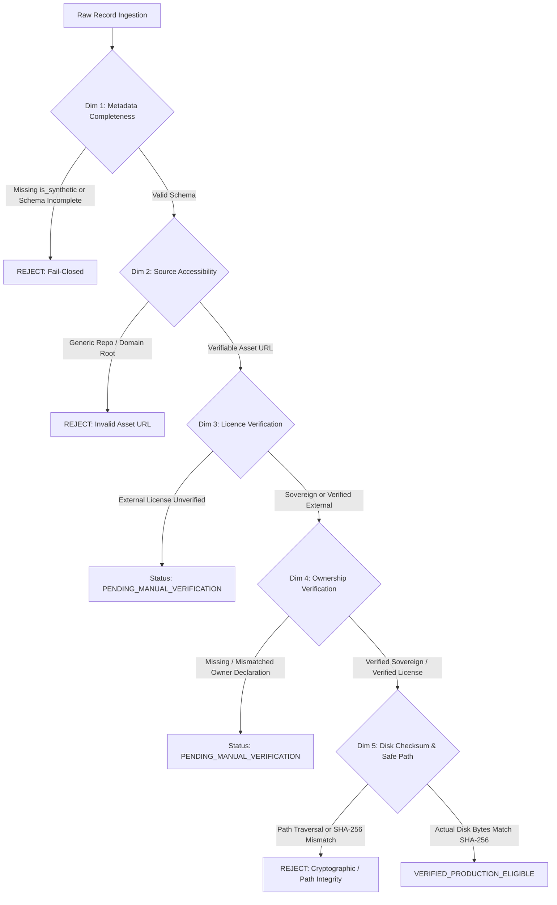

# MOON AI — STAGE 2.0.2: PROVENANCE GATE HARDENING & ADVERSARIAL DATASET SECURITY AUDIT

**Repository:** `Prem759-0/NanoGPT`  
**Branch:** `feature/stage-2-0-2-provenance-hardening`  
**Base Commit:** `e0b141f02baab0f97fbe7cb2f31bbba3dba8ae31` (Stage 2.0.1)  
**Project Owner & Lead ML Systems Architect:** Prem Gaikwad (India 🇮🇳)  
**Ownership Policy:** `STRICT_SOVEREIGN_RANDOM_INIT_ONLY`

---

## 1. Executive Summary & Security Objectives

Stage 2.0.2 delivers a zero-trust, fail-closed provenance validation engine and adversarial security hardening for Moon AI's dataset pipeline. Following the quarantine of procedural fixtures in Stage 2.0.1, Stage 2.0.2 ensures that no asset can enter production manifests or training pipelines without passing cryptographic, legal, and provenance verification.

### Core Guarantees Enforced:
1. **Explicit Boolean Provenance:** The `is_synthetic` flag is strictly required and must be explicitly `false` for production records. Missing fields are never defaulted to `false` and cause immediate rejection.
2. **Cryptographically Bound Ownership Declarations:** Sovereign strings like `"CustomSovereign"`, `"owner://"`, or creator names alone do **NOT** prove ownership. Self-created media requires an explicit `owner_declaration` specifying declarant, ISO 8601 timestamp, matching asset SHA-256, and rights certification.
3. **Verified External Licences:** Third-party media must supply an explicit `license_evidence` record confirming `VERIFIED_PERMISSIBLE` status and commercial/unrestricted rights.
4. **Actual Disk Byte Checksum & Safe Path Verification:** Files are checked against path traversal attacks (`..`, Windows drive roots). The validator reads raw file bytes in 64KB chunks from disk, recomputes SHA-256 digests, and verifies bit-for-bit equality against manifest declarations.
5. **Adversarial Test Suite:** 12 adversarial unit tests prove that every failure mode, forgery attempt, disguised synthetic fixture, and traversal attack fails closed.
6. **Multi-Dimensional Decoupled Auditing:** Technical hygiene (`HYGIENE_VALID`), licensing verification, ownership verification, and training eligibility are decoupled. Production eligibility remains 0 until genuine media is ingested and verified.

---

## 2. The 5-Dimensional Provenance & Security Engine

The core engine is implemented in [`datasets/tools/provenance_validator.py`](file:///datasets/tools/provenance_validator.py) and called by ingestion tools, dataset loaders, and audit scripts.



### Dimension 1: Metadata Completeness & Schema Integrity
- Explicit check: `"is_synthetic" in record and record["is_synthetic"] is False`. Missing field is an immediate rejection.
- Mandatory fields: `id`, `creator`, `source_url`, `license`, `sha256`, `caption`, and media path (`media_path`, `image_path`, `video_path`).
- Caption quality gate: Minimum 10 characters, rejection of generic placeholders (`"an image"`, `"photo"`, `"sample"`).
- Modality checks: Valid categories for images; valid camera motion, minimum 8.0 FPS, and minimum 1.0s duration for videos.

### Dimension 2: Source Accessibility & Asset-Level Verification
- Rejects generic domain roots (e.g. `https://unsplash.com`, `https://example.com`).
- Rejects bare `owner://` prefixes without asset-level identifiers.
- Rejects fabricated or self-referential repo paths (`github.com/Prem759-0/NanoGPT/tree/...`).

### Dimension 3: Licence Verification (External Open Licences)
- External open-source assets (CC0, CC-BY-4.0, MIT, Apache-2.0, etc.) require:
  ```json
  "license_evidence": {
    "license_url": "https://creativecommons.org/publicdomain/zero/1.0/",
    "verification_status": "VERIFIED_PERMISSIBLE",
    "commercial_use_permitted": true
  }
  ```
- Unverified licenses are categorized as `PENDING_MANUAL_VERIFICATION` and excluded from production manifests.

### Dimension 4: Ownership Verification (Sovereign Assets)
- For `CustomSovereign` or `owner://` schemes, requires:
  ```json
  "owner_declaration": {
    "declarant": "Prem Gaikwad",
    "declaration_timestamp": "2026-11-01T00:00:00Z",
    "asset_sha256": "4a7d...64hex",
    "rights_statement": "I certify this is an original capture created by me with full commercial rights."
  }
  ```
- Declarant must match creator; timestamp must be valid ISO 8601; `asset_sha256` must cryptographically match the manifest record and actual file bytes.

### Dimension 5: Actual Byte Checksum & Safe Path Resolution
- `validate_safe_path()` prevents directory traversal (`../`, absolute Windows paths `C:\`, invalid extensions).
- `verify_file_checksum()` reads raw chunks of 65,536 bytes from disk, computes the actual SHA-256, and verifies exact equality.

---

## 3. Adversarial Test Suite

Located at [`tests/test_adversarial_provenance.py`](file:///tests/test_adversarial_provenance.py), the 12 unit tests verify:

| Test Case | Attack / Vulnerability Tested | Expected Result | Pass Status |
| :--- | :--- | :--- | :--- |
| `test_missing_is_synthetic_rejected` | Record omitting `is_synthetic` completely | Fail-closed rejection | ✅ PASS |
| `test_explicit_synthetic_rejected` | Record with `is_synthetic: true` | Rejection from production | ✅ PASS |
| `test_non_boolean_synthetic_rejected` | Disguised string `"false"` or integer `0` | Strict boolean check rejects | ✅ PASS |
| `test_sovereign_string_without_declaration` | Mere string `"CustomSovereign"` without declaration | Blocked as `PENDING_MANUAL_VERIFICATION` | ✅ PASS |
| `test_mismatched_owner_declaration_sha256` | Owner declaration SHA-256 does not match asset | Blocked as `PENDING_MANUAL_VERIFICATION` | ✅ PASS |
| `test_generic_repo_url_rejected` | Self-referential repo directory URL | Rejection for invalid source URL | ✅ PASS |
| `test_generic_domain_root_rejected` | Unqualified domain root (e.g. `https://unsplash.com`) | Rejection for missing asset ID | ✅ PASS |
| `test_external_license_without_evidence` | CC0 license lacking `license_evidence` | Blocked as `PENDING_MANUAL_VERIFICATION` | ✅ PASS |
| `test_file_checksum_mismatch_rejected` | Forged SHA-256 differing from file bytes | Rejection on cryptographic mismatch | ✅ PASS |
| `test_missing_media_file_rejected` | Manifest references non-existent file on disk | Rejection on missing file | ✅ PASS |
| `test_path_traversal_attack_rejected` | Malicious relative paths (e.g. `../../etc/passwd`) | Rejection on directory traversal | ✅ PASS |
| `test_legitimate_verified_record_passes` | Fully compliant sovereign record with actual media | `VERIFIED_PRODUCTION_ELIGIBLE` | ✅ PASS |

---

## 4. Pipeline & Training Integration

1. **Ingestion Tools Hardened:**
   - [`datasets/tools/collect_images.py`](file:///datasets/tools/collect_images.py) & [`datasets/tools/collect_videos.py`](file:///datasets/tools/collect_videos.py) now execute `validate_provenance_record(..., verify_file=True)` before permitting records into production manifests.
2. **Dataset Loaders Fail-Closed:**
   - [`training/image/dataset.py`](file:///training/image/dataset.py) (`MoonImageDataset`) and [`training/video/dataset.py`](file:///training/video/dataset.py) (`MoonVideoDataset`) validate every sample on load. If any record fails `training_eligible`, or if 0 verified genuine records exist, a strict `ValueError` is raised.
3. **Decoupled Audit Metrics:**
   - [`datasets/tools/dataset_manager.py`](file:///datasets/tools/dataset_manager.py) separately logs all 10 Stage 2.0.2 metrics in both JSON and Markdown formats.

---

## 5. Verification Results

- **Unit Tests:** 62 tests run across the full test suite (`test_adversarial_provenance`, `test_dataset_foundation`, `test_provenance_repair`, etc.) — **62 PASSED, 0 FAILED**.
- **Frontend Build:** Vite v8.3.5 production build completed in 6.68s — **SUCCESS**.
- **Model Registry:** All 4 Moon models (`moon-image-v0`, `moon-video-v0`, `moon-chat-v0`, `moon-code-v0`) correctly remain in `DATA_INSUFFICIENT` state with `training_ready: false`.
- **Pilot Data Blockers Remaining:** Production training remains blocked pending ingestion of 500 genuine images and 50 genuine videos under the new hardened gate.
