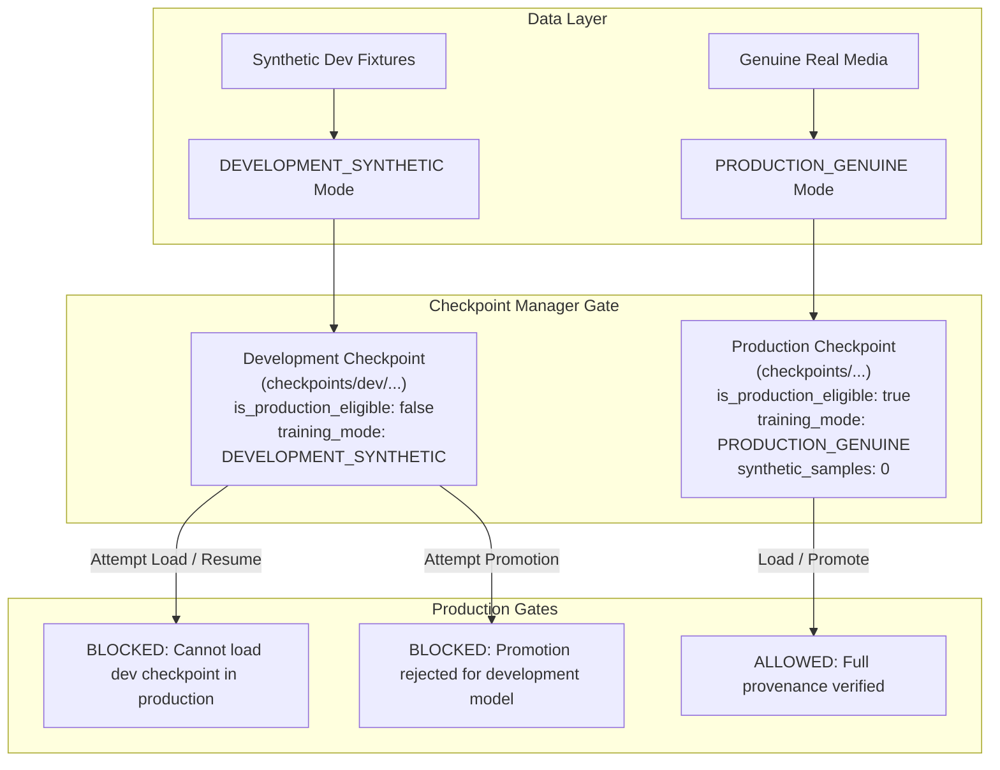

# MOON AI — STAGE 2.0.3: TRAINING ISOLATION, CHECKPOINT SECURITY & PROVENANCE ATTESTATION

**Repository:** `Prem759-0/NanoGPT`  
**Branch:** `feature/stage-2-0-3-training-isolation`  
**Base Commit:** `f74fb94d5dc3daae742747bb4ab0f407bfcdcb3c` (Stage 2.0.2)  
**Project Owner & Lead ML Systems Architect:** Prem Gaikwad (India 🇮🇳)  
**Ownership Policy:** `STRICT_SOVEREIGN_RANDOM_INIT_ONLY`

---

## 1. Executive Summary & Baseline

Stage 2.0.3 establishes cryptographic training isolation, hardened checkpoint provenance, symlink traversal immunity, and honest multi-state ownership attestation.



---

## 2. Hardened Architecture & Security Implementations

### Task 1 & 2 — Checkpoint Security & Strict Provenance Manager
Implemented in [`training/common/checkpoint.py`](file:///training/common/checkpoint.py), [`training/image/train.py`](file:///training/image/train.py), and [`training/video/train.py`](file:///training/video/train.py):
1. **Explicit Training Provenance Modes:**
   - `PRODUCTION_GENUINE`
   - `DEVELOPMENT_SYNTHETIC`
2. **Fail-Closed Manager-Level Enforcement:**
   - `save_checkpoint()` prohibits setting `is_production_eligible=True` for `DEVELOPMENT_SYNTHETIC` training.
   - Development checkpoints are restricted from writing to production model paths (`.../best_moon_image.pt`) and must be directed to development subdirectories (`checkpoints/dev/...`).
   - `save_checkpoint()` in `PRODUCTION_GENUINE` mode strictly fails if any synthetic samples are present (`synthetic_sample_count > 0`).
3. **Comprehensive Provenance Payload:**
   Every saved checkpoint stores:
   - `model_name` and `architecture_version` (`moon_arch_v1.0`).
   - Sovereign initialization provenance (`provenance="moon_ai_random_init"`).
   - `training_mode` (`PRODUCTION_GENUINE` or `DEVELOPMENT_SYNTHETIC`).
   - `is_production_eligible` (`bool`).
   - `manifest_path` and `manifest_hash` (SHA-256).
   - `val_manifest_path` and `val_manifest_hash` (SHA-256).
   - `dataset_record_counts` (`{"total": int, "train": int, "val": int}`).
   - `synthetic_sample_count` and `production_eligible_sample_count`.
   - `training_timestamp` (ISO 8601 UTC).
   - `software_version` and `git_commit` SHA.
   - Complete RNG states (Torch CPU/CUDA, Python random, NumPy) and optimizer/scaler/scheduler state dicts.
4. **Load & Resume Protection (`load_checkpoint`):**
   - Mode parameter: `mode="PRODUCTION_GENUINE"`.
   - Rejects any checkpoint missing `training_mode`.
   - Rejects loading or resuming a production run from a `DEVELOPMENT_SYNTHETIC` checkpoint.
   - Detects and rejects metadata tampering (e.g. claiming `is_production_eligible=True` while `training_mode` is `DEVELOPMENT_SYNTHETIC`).
5. **Model Promotion Gate:**
   - [`scripts/promote_best_model.py`](file:///scripts/promote_best_model.py) validates the underlying checkpoint via `verify_checkpoint_provenance()`. Rejects candidate models marked `DEVELOPMENT_SYNTHETIC` or referencing development paths.

---

### Task 3 — Symlink Traversal Immunity
Implemented in [`datasets/tools/provenance_validator.py`](file:///datasets/tools/provenance_validator.py) within `validate_safe_path()`:
- Resolves real canonical paths using `os.path.realpath()` before containment validation.
- Detects symlinks and junctions pointing outside the dataset base directory.
- Rejects paths escaping root, directory traversals (`..`, `../`), absolute Windows drive letters, and unauthorized file extensions.

---

### Task 4 & 5 — Honest Provenance Attestation & Source Accessibility
Implemented in [`datasets/tools/provenance_validator.py`](file:///datasets/tools/provenance_validator.py):
1. **Four Explicit Verification States:**
   - `SELF_DECLARED`: Creator has provided a structurally valid `owner_declaration`. Self-attestation alone is **NOT** treated as independent proof of ownership.
   - `PENDING_MANUAL_VERIFICATION`: Awaiting independent external verification or unverified external licence evidence.
   - `EXTERNALLY_VERIFIED`: Independently audited by an external verifier or certified open license.
   - `REJECTED`: Declarant mismatch, hash mismatch, or invalid license.
2. **Separated Source Accessibility Dimensions:**
   - `url_syntax_valid`: URL format validation (`http://`, `https://`, `owner://`).
   - `asset_level_source_identified`: Verifies resource points to an asset file, rejecting domain roots and internal repository directory paths.
   - `url_accessibility`: Recorded as `PENDING_MANUAL_VERIFICATION` in offline environments. No URL is considered verified merely because it begins with HTTPS.

---

### Task 6 — Manifest Integrity
Implemented in [`training/video/dataset.py`](file:///training/video/dataset.py) and [`training/image/dataset.py`](file:///training/image/dataset.py):
- Discontinued silent skipping of malformed JSON lines.
- Manifest parsing strictly raises a `ValueError` reporting the exact manifest file and line number:
  ```text
  JSON decode error in '<manifest_path>' line <line_no>: <error>
  ```
- Recomputes file byte checksums during validation.

---

## 3. Test Suite Verification

### New Test Suite: `tests/test_checkpoint_security_and_provenance.py`
Contains 11 unit tests covering all required failure and admittance modes:
1. `test_synthetic_dev_training_cannot_produce_production_checkpoint`: PASS
2. `test_production_loader_rejects_synthetic_checkpoints`: PASS
3. `test_production_model_promotion_rejects_development_checkpoints`: PASS
4. `test_missing_checkpoint_training_mode_rejected`: PASS
5. `test_tampered_checkpoint_metadata_rejected`: PASS
6. `test_symlink_escape_rejected`: PASS
7. `test_corrupt_video_manifest_json_fails_with_line_number`: PASS
8. `test_self_declared_ownership_remains_unverified`: PASS
9. `test_external_licence_claims_without_evidence_remain_blocked`: PASS
10. `test_production_training_rejects_any_unverified_dataset_record`: PASS
11. `test_genuine_fully_verified_fixture_passes_production_validation`: PASS

### Overall Repository Test Discovery
- **Total Tests Run:** 75
- **Result:** 75 Passed, 0 Failed, 0 Errors (in 26.852s)
- **Frontend Production Build:** Vite build succeeded in 7.02s with 0 errors.

---

## 4. Absolute Sovereign Ownership Assurances

1. **Random Initialization Enforced:** All Moon architectures initialize exclusively from random Gaussian weights.
2. **Zero Third-Party Pretrained Weights:** No checkpoints or encoders downloaded or loaded.
3. **Zero Generative APIs:** No external hosted models (OpenAI, Anthropic, Pollinations, Replicate).
4. **Production Blockers Maintained:** Production training remains fail-closed and blocked until 500 genuine images and 50 genuine videos are collected and externally verified.
